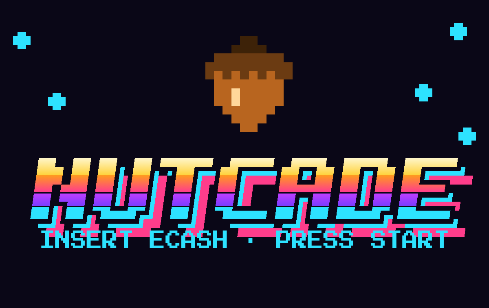
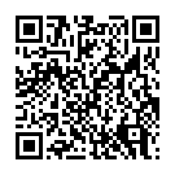

# NUTCADE

A Cashu ecash wallet with a 1980s arcade built in.

**Open it:** https://nutcade-2c150c.gitlab.io

NUTCADE holds Bitcoin as Cashu ecash: fast, private payments you can send like a text message. It works in any modern browser on phone or desktop, with nothing to install, and keeps your wallet protected by a standard 12-word recovery phrase.

## Features

**Wallet**
- Send and receive **ecash**, **Lightning** and **on-chain** Bitcoin (on-chain needs a mint that supports NUT-30)
- **Scan QR codes** with the camera or from a photo: ecash tokens, Lightning invoices, Lightning addresses, LNURL, Bitcoin addresses (BIP21) and mint addresses
- Pay any **Lightning address** (like name@wallet.com) by typing or scanning it
- **Your own Lightning address** (npub…@npub.cash) that anyone can pay from any Lightning wallet. It comes from your 12 words, so it's the same address cashu.me gives them
- **Multinut payments** (NUT-15): pay one Lightning invoice from several mints at once when no single mint holds enough. Every part settles together, or all the sats come back
- **Payment requests** (NUT-18): make a request (amount and note optional) that any Cashu wallet, like cashu.me, can pay. The ecash arrives privately over Nostr, even while the request screen is closed. You can also pay requests other people send you, over Nostr or HTTP
- **NFC** (Chrome on Android): write ecash or a payment request onto an NFC card or sticker, and tap a card to receive. Small cards get a compact format that cashu.me also reads
- **Instant updates**: deposits, payments and claimed tokens show up the moment the mint confirms them (NUT-17), with a regular check as backup
- **Mint list backup on Nostr** (NUT-27): your mint list is saved encrypted, so restoring from 12 words finds your mints for you, here or in cashu.me
- **PIN lock** with your wallet encrypted on the device, plus optional **Face ID / fingerprint** unlock
- Use several mints at once and switch between them
- Pick mints from a curated list, by address, or from recommendations on Nostr (NIP-87)
- Claim ecash from a mint you don't use yet, or swap it into your own mint over Lightning
- Private **notes on every transaction**, searchable and filterable
- **Live Bitcoin price chart** in arcade style: 1H, 1D, 1W, 1M and 1Y ranges, high and low markers, touch or hover to read any point, and your balance's value updating live
- Take back a sent token if nobody claimed it, and see when one was claimed
- Coin-drop and 1UP effects when sats arrive, and a launch effect when you send

**Arcade**: seven original cabinets with high-score tables, chiptune sound and music

| Cabinet | Style |
|---|---|
| Star Swarm | Diving-formation space shooter |
| Nut Maze | Maze chase with a new maze every level |
| Brick Blitz | Paddle and ball |
| Void Rocks | Vector rock shooter |
| Hop Lanes | Road and river crossing |
| Sky Shield | Missile defense |
| Nibble | Snake |

Plays with keyboard, mouse, or the on-screen joystick and buttons on a phone.

**Trophies and score cards**: 21 trophies for wallet milestones and arcade feats (reach wave 3 in Star Swarm, grow Nibble to 30, play every cabinet…). Every high score and trophy can be turned into a share card for X or anywhere else. Cards show the game and score only, never anything about your wallet, and trophies stay on your device.

**Settings**
- **Security:** set, change or remove your PIN, turn on Face ID / fingerprint, lock now, and choose when the wallet locks itself
- **Backup:** show your phrase, find lost ecash, back up your mint list to Nostr, download or import a backup file, restore a wallet from 12 words, reset the wallet
- **Lightning address:** turn on your own address, choose which mint receives the payments, check for payments, turn it off
- **Look & sound:** three cabinet themes (Neon, Amber CRT, Green phosphor), sound effects, music, CRT scanlines, amounts shown as ₿
- **Privacy:** turn the live price and price chart on or off (prices come from Coinbase, in your currency), and choose whether to check if sent tokens were claimed
- **Wallet tools:** remove spent ecash and check stuck payments
- **About:** version, links and donations

## Getting started

1. Open https://nutcade-2c150c.gitlab.io. On iPhone, tap Share → **Add to Home Screen** first and open NUTCADE from that icon, so Safari keeps your wallet.
2. Tick the box to say you understand, then tap **Create a new wallet**.
3. Write your **12 words** on paper, in order. Then type back the three words NUTCADE asks for.
4. Set a PIN when NUTCADE offers it (recommended).
5. Choose a mint. Try **Testnut** first if you want to play with fake sats.
6. Tap **Receive** to add sats, and write the mints you use next to your 12 words.

### Moving from another wallet

Already have a Cashu wallet, like cashu.me or an earlier NUTCADE? On the welcome screen tap **Restore from recovery phrase**, or later go to **Settings → Backup → Restore wallet from 12 words**. Enter your 12 words, tap **Find my mints on Nostr** to tick the mints from your backup, and add any others you used. NUTCADE uses the same standard as cashu.me (NUT-13), so the same words work in both. If NUTCADE already holds sats, they move into the restored wallet.

### Requesting and paying with payment requests

To ask for sats, tap **Receive → Ecash → Request a payment**, add an amount and what it's for if you like, and share the code or QR. With **Only from my mints** on (the default), the payer has to use one of your mints, so you never receive ecash from a mint you don't trust. Payments land in your wallet whenever NUTCADE is open, and ones sent while it was closed arrive the next time you open it, for 30 days.

To pay someone's request, scan it or paste it (it starts with creqA). NUTCADE shows what it's for and which of your mints can pay, then sends the ecash straight to them. If it can't be delivered, the ecash stays in your notes so you can send it another way or take it back.

### Paying from several mints

If the mint you're using doesn't hold enough to pay a Lightning invoice, the quote screen offers **Pay from several mints**. NUTCADE asks each mint that supports multi-path payments for a share, shows you the split and the fees, then pays all the parts together. This needs at least two of your mints to support NUT-15.

### NFC cards

On an Android phone with Chrome, the scanner has a **Tap NFC** button, and token and request screens have **Write to NFC**. Hold a card to the back of the phone. iPhones don't allow websites to use NFC, so these buttons don't appear there.

### Getting your own Lightning address

Go to **Settings → Lightning address → Set it up**, pick the mint that should receive payments, and tap **Turn on**. Share the address shown, or find it any time on the **Receive → Lightning** screen. Payments are turned into ecash at your mint by npub.cash, and NUTCADE claims them whenever it's open. If you used a Lightning address in cashu.me with the same 12 words, it's the same address here.

### Starting over

**Settings → Backup → Reset wallet** deletes the wallet from this browser and returns you to the start screen to create a new one or restore one. Write down your 12 words and mints first if there are sats in it.

## Safety

- **PIN lock and encryption.** With a PIN set, your phrase, ecash, history and notes are stored encrypted (AES-256-GCM). The key is unlocked by your PIN (PBKDF2, 600,000 rounds) or by a Face ID / fingerprint passkey (WebAuthn PRF). Five wrong PINs trigger a growing wait, and the wallet locks itself after the time you choose. A PIN stops someone who picks up your phone; it can't stop malware on a compromised device. If you forget it, reset and restore with your 12 words.
- **Recovery phrase first.** You can't use the wallet until you've written down your 12 words and confirmed them. Every piece of ecash is derived from them (NUT-13), and restoring scans your mints to rebuild your balance (NUT-09).
- **Interrupted payments are handled.** A failed Lightning payment returns your sats. A stuck one is tracked until the mint settles it. A deposit interrupted mid-way is recovered automatically the next time you open the app.
- **Mint list backup.** Your list of mints is saved to Nostr relays encrypted with a key from your 12 words (NUT-27, the same format cashu.me uses), so a restore can find them even if you lose your note. Only the list is saved, never ecash or amounts. You can turn this off in Settings → Backup.
- **Same phrase on two devices.** If a mint reports reused codes, NUTCADE catches up and retries on its own.
- **One tab at a time.** If NUTCADE is open in a second tab, that tab pauses so the two can't overwrite each other.
- **Storage protection.** NUTCADE asks the browser not to clear its data, and Settings shows whether that was granted.
- **No outside code.** The app is one self-contained file with its fonts built in. The QR decoder loads from this same site, only when you open the scanner. Nothing is loaded from other servers.
- **Checked releases.** Every update runs the test suites automatically before it goes live, and the site publishes SHA-256 checksums at https://nutcade-2c150c.gitlab.io/SHA256SUMS.txt. See [RELEASING.md](RELEASING.md).

**Important:** your wallet lives in your browser. Keep your 12 words and your mint list somewhere safe and offline. Never type your words into a website or send them to anyone, including anyone claiming to be NUTCADE support. Mints hold the Bitcoin behind your ecash, so only use mints you trust. NUTCADE is young software that hasn't been independently audited, so start with small amounts.

## Testing

Every push runs the suites in `tests/` automatically in GitLab against real Cashu mints (Nutshell), including mints set up to fail or stall payments. The site only updates if every check passes:

- 51 wallet checks: Lightning in and out, ecash between wallets, double-claim protection, failed and stuck payments, notes, multiple mints, backup files, and restoring from the phrase after a full wipe
- 27 settings checks: themes, ₿ display, backup download and import, restoring a phrase from another Cashu client, reset, and swapping received ecash into your own mint
- Crash recovery: a deposit interrupted mid-way comes back on the next open
- 28 PIN-lock checks: encryption at rest, wrong PINs and lockout, change and removal, Face ID / fingerprint unlock, auto-lock, and forgot PIN followed by restore
- 41 checks for multinut payments, payment requests (over Nostr and HTTP, including ecash sent by another wallet) and NFC reading and writing
- 39 checks for trophies, share cards, instant updates, the Nostr mint-list backup and the Lightning address, against a stand-in Nostr relay and npub.cash server that check every signature
- 24 scanner checks, run before release: camera scans of real tokens and invoices, photo scans, and recognising every kind of code
- All seven games played through to game over, with high scores, pause, exit, touch controls and sound
- Every screen at 320, 390, 768 and 1280 pixels wide, checked for overflow and clipped text

## Privacy

NUTCADE has no account, no tracking and no analytics. Your recovery phrase and notes stay in your browser, and mints only see the ecash you exchange with them. The app contacts other services only for these things:

- **Mints**: yours for every payment, and the ones listed in the mint picker to show whether they're online
- **Coinbase**, for the price and chart, only while **Show Bitcoin price** is on
- **Nostr relays** (relay.damus.io, nos.lol, relay.primal.net), to save your encrypted mint list when it changes and to look for it when you restore (turn this off in Settings → Backup), to receive payments for requests you made in the last 30 days, to deliver payments to requests you pay, and when you tap "Find mints people recommend". Payments you send over Nostr are signed with a one-time key, so they aren't linked to you
- **npub.cash**, only while your Lightning address is turned on. It sees the amounts and times of payments to your address, not the rest of your wallet
- **The donation address** (breez.tips), only when you tip from inside the app

## Sharing

Posting the link on X and most social sites shows a large preview card automatically. A bigger version of the picture for attaching to posts is at https://nutcade-2c150c.gitlab.io/nutcade-share.png.

## For maintainers

The app is one file, `public/index.html`, plus the QR decoder `public/zxing_reader.wasm`. On every push to `main`, `.gitlab-ci.yml` runs the test suites and then publishes `public/` to GitLab Pages with fresh checksums. To ship an update, replace `public/index.html` and push. [RELEASING.md](RELEASING.md) covers running the tests yourself, cutting a release and signing it. Wallets people already have keep their sats, and visitors get the new version within a few minutes.

## Support the project

NUTCADE is free and open source, and it stays that way. Supporting it is optional and changes nothing about how it works. If you enjoy it, you can send a few sats over Lightning:

**dev@breez.tips**

You can also tip from inside NUTCADE: **Settings → About → Donate**. The same address and code are on that screen. Be wary of any other "NUTCADE donation" address.

## Changelog

- **v1.6.0:** multinut payments across several mints (NUT-15), payment requests to create and pay (NUT-18 over Nostr and HTTP), NFC cards for ecash and requests, opening tokens from links
- **v1.5.0:** your own Lightning address (npub.cash, same as cashu.me), instant updates over mint websockets (NUT-17), encrypted mint-list backup on Nostr with "Find my mints" when restoring (NUT-27), 21 trophies, share cards for high scores and trophies

- **v1.4.0:** QR scanner (camera and photo), paying Lightning addresses, PIN lock with encrypted storage and Face ID / fingerprint unlock, auto-lock, coin-drop and 1UP effects, fonts built in (no more Google Fonts), automatic tests in GitLab before every release, published SHA-256 checksums
- **v1.3.0:** live Bitcoin price chart on the wallet screen, live balance value, share image and link preview for X and other social sites
- **v1.2.0:** wallet setup before entry, Settings tab, restore a wallet from 12 words (including from cashu.me), reset wallet, automatic recovery of interrupted deposits, automatic repair when one phrase is used on two devices, claiming ecash before choosing a mint, clearer error messages, brighter logo tagline
- **v1.1.0:** 12-word recovery phrase, restore, find lost ecash, one-tab lock, storage protection, donation section, logo and app icons
- **v1.0.0:** first release: ecash, Lightning and on-chain wallet, transaction notes, seven arcade games, sound

## Open-source components

The page bundles these libraries (their license notices are at the end of the bundled script):

- [cashu-ts](https://github.com/cashubtc/cashu-ts)
- [noble-curves, noble-hashes, scure-base, scure-bip32, scure-bip39](https://paulmillr.com/noble/)
- [qrcode-generator](https://github.com/kazuhikoarase/qrcode-generator)
- [zxing-wasm](https://github.com/Sec-ant/zxing-wasm) (MIT) with [zxing-cpp](https://github.com/zxing-cpp/zxing-cpp) (Apache-2.0), the QR decoder
- [jsQR](https://github.com/cozmo/jsQR) (Apache-2.0), the fallback QR decoder
- [nostr-tools](https://github.com/nbd-wtf/nostr-tools) (Unlicense) and [noble-ciphers](https://github.com/paulmillr/noble-ciphers) (MIT), for signing Nostr events and NIP-44 encryption

Fonts: [Press Start 2P](https://fonts.google.com/specimen/Press+Start+2P) and [VT323](https://fonts.google.com/specimen/VT323), both under the SIL Open Font License.
