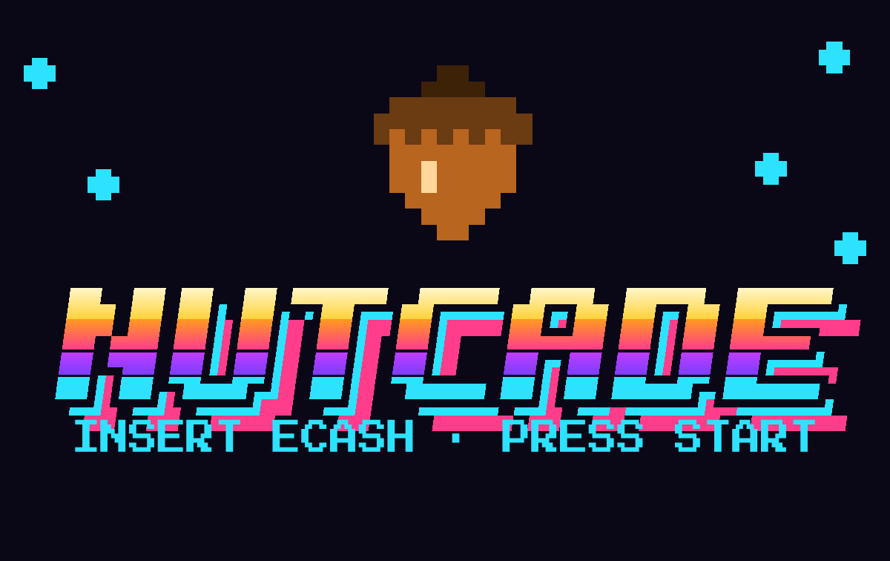
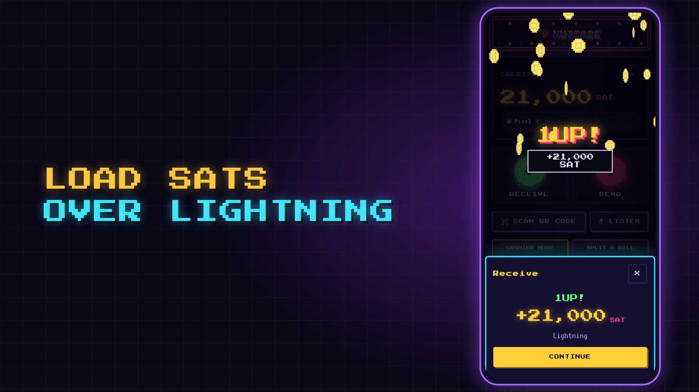
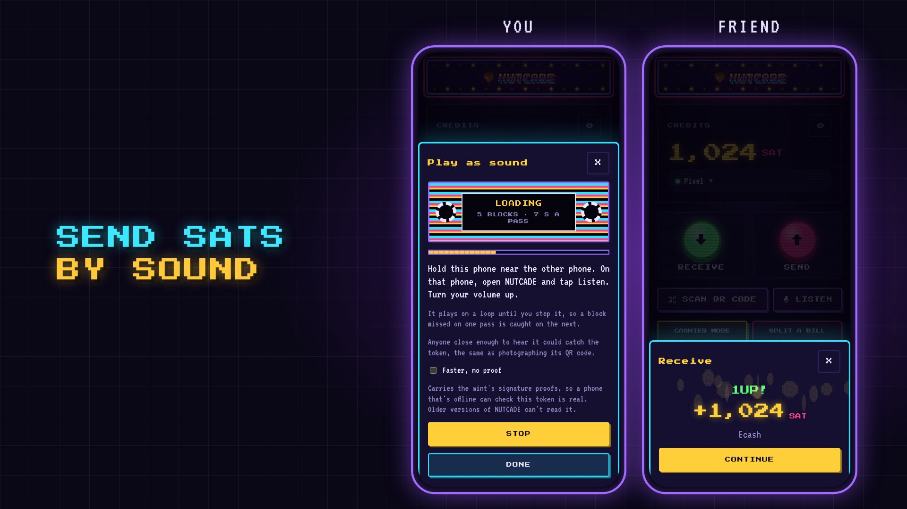
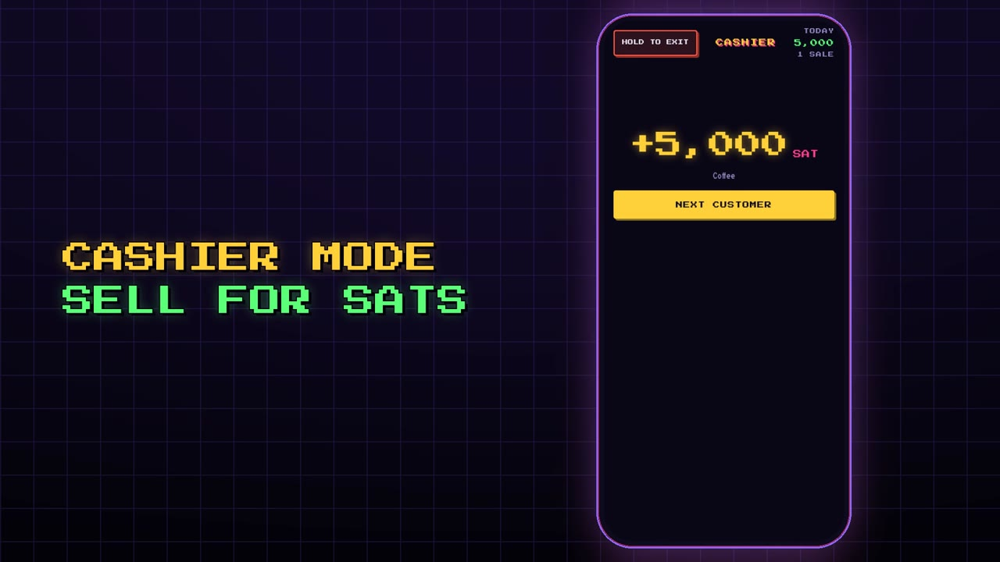
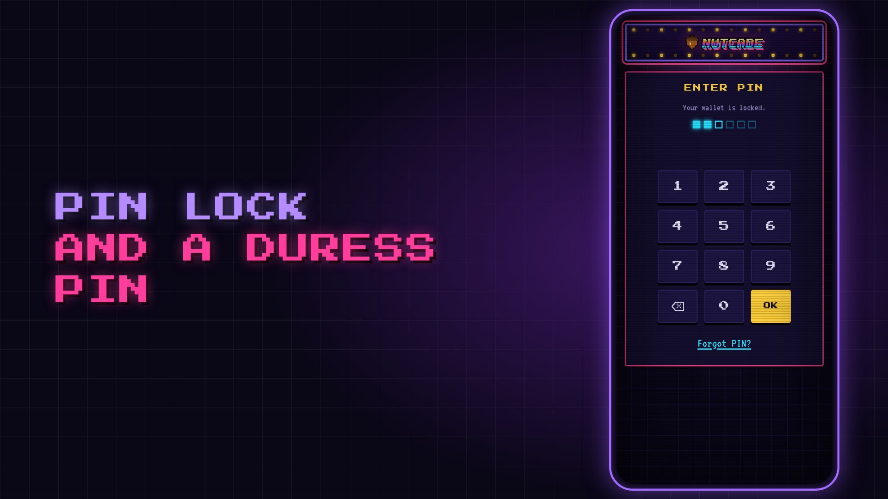

# NUTCADE

A Cashu ecash wallet with a 1980s arcade built in.

**Open it:** https://random21m.github.io/nutcade/

**Timestamped in Bitcoin:** NUTCADE v1.8.1, including the send-by-sound chiptune modem, is anchored in [block 975,501](https://mempool.space/block/00000000000000000000c8328fa2baa44180bc59c74d739bfb317dd984ade480), mined 11 November 2026. The proof covers the release checksums, and the checksum for `index.html` covers the sound code inside it. The proof, `SHA256SUMS.txt.ots`, is attached to the [v1.8.1 release](https://github.com/Random21m/nutcade/releases/tag/v1.8.1); check it at [opentimestamps.org](https://opentimestamps.org).

**Send by sound, timestamped on its own:** the sound modem's source, [`src/chiptune.js`](src/chiptune.js) (SHA-256 `77cb1714…c1c48f9`, unchanged since), is anchored in [block 975,513](https://mempool.space/block/00000000000000000000ffe72c5aff0f1b98e79bc4353e3345c48208cb23f1fb), mined 11 November 2026. The proof is [`docs/chiptune.js.ots`](docs/chiptune.js.ots); check it with `ots verify -f src/chiptune.js docs/chiptune.js.ots` or at [opentimestamps.org](https://opentimestamps.org).

> **Moved from GitLab.** NUTCADE now lives on GitHub. The old address (nutcade-2c150c.gitlab.io) is no longer updated. Each address keeps its own wallet in your browser, so to move: write down your 12 words (Settings → Backup → Show recovery phrase), open the new address, and tap **Restore from recovery phrase**.

NUTCADE holds Bitcoin as Cashu ecash: fast, private payments you can send like a text message. It works in any modern browser on phone or desktop, with nothing to install, and keeps your wallet protected by a standard 12-word recovery phrase.

## Get NUTCADE: add it to your home screen

**The only real address is https://random21m.github.io/nutcade/** · There's no app-store app; anything else calling itself NUTCADE isn't us.

Adding it to your home screen makes NUTCADE open full-screen like an app and work offline. **On iPhone it also keeps your wallet safe:** Safari can clear the storage of websites you haven't opened in a while, but a Home Screen app keeps it.

| Device | Steps |
|---|---|
| **iPhone / iPad** (Safari) | 1. Open the link above in **Safari**. 2. Tap **Share** (the square with an arrow; on newer iOS, tap **•••** first). 3. Tap **Add to Home Screen**, then **Add**. 4. From now on, open NUTCADE from the new icon. |
| **Android** (Chrome) | 1. Open the link in **Chrome**. 2. Tap **⋮** (top right). 3. Tap **Install app** or **Add to Home screen**, then **Install**. 4. Open it from the new icon. |
| **Computer** (Chrome or Edge) | Open the link and click the **install icon** at the right end of the address bar (or **⋮ → Install NUTCADE**). It opens in its own window. |
| **Mac** (Safari) | Open the link, then **File → Add to Dock**. |

**Good to know**
- Each browser and each icon keeps its own wallet. Set it up once in the place you'll use it.
- Write down your **12 words** when you create the wallet. They're the only way back if the phone is lost or the browser data is cleared.
- Updates arrive by themselves: the next time you open NUTCADE, it loads the new version, and a note tells you what's new. If you keep NUTCADE open for days, a message says when a new version is ready, and you reload when you're done (never in the middle of a payment).

<table>
<tr><td></td><td></td></tr>
<tr><td></td><td></td></tr>
<tr><td></td><td></td></tr>
<tr><td></td><td></td></tr>
</table>

## Features

**Wallet**
- Send and receive **ecash**, **Lightning** and **on-chain** Bitcoin (on-chain needs a mint that supports NUT-30)
- **Scan QR codes** with the camera or from a photo: ecash tokens, Lightning invoices, Lightning addresses, LNURL, Bitcoin addresses (BIP21) and mint addresses
- Pay any **Lightning address** (like name@wallet.com) by typing or scanning it
- **LNURL vouchers** (LNURL-withdraw, LUD-03): scan or paste a voucher to load its sats into the mint you pick. You see its description and limits, choose the amount (the most it gives, unless you change it), and NUTCADE asks the voucher to pay an invoice for exactly that amount
- **Zaps** (NIP-57): zap a contact or any npub. NUTCADE finds the Lightning address in their Nostr profile and signs the zap with your wallet's Nostr key, the one that comes from your 12 words. The invoice must be for exactly what you asked, and you see the fee before you pay. If their address can't take zaps, you're offered a plain Lightning payment instead
- **Nostr Wallet Connect** (NIP-47): let another app, like a Nostr client, pay and receive with this wallet. Give each connection a name and, if you like, a budget per day, week, month or in total. It answers only while NUTCADE is open and unlocked in a tab
- **Block a mint**: tokens, payment requests and deposits from a blocked mint are refused, and you're always told why, with an Unblock button. Sats you already hold there stay yours to send or move out
- **Your own Lightning address** (npub…@npub.cash) that anyone can pay from any Lightning wallet. It comes from your 12 words, so it's the same address cashu.me gives them
- **Multinut payments** (NUT-15): pay one Lightning invoice from several mints at once when no single mint holds enough. Every part settles together, or all the sats come back
- **Payment requests** (NUT-18): make a request (amount and note optional) that any Cashu wallet, like cashu.me, can pay. The ecash arrives privately over Nostr, even while the request screen is closed. You can also pay requests other people send you, over Nostr or HTTP
- **NFC** (Chrome on Android): write ecash or a payment request onto an NFC card or sticker, and tap a card to receive. Small cards get a compact format that cashu.me also reads
- **Notices when money arrives**: a short notice with the amount, where it came from and the mint, and on opening or unlocking a "while you were away" summary (count and total per kind, exactly the lines in your notes). Optional system notifications, shown by this device only: no server, no push service, nothing sent anywhere. With a PIN they never show an amount; with a duress PIN set, both wallets show exactly what a PIN alone shows.
- **Instant updates**: deposits, payments and claimed tokens show up the moment the mint confirms them (NUT-17), with a regular check as backup
- **Mint list backup on Nostr** (NUT-27): your mint list is saved encrypted, so restoring from 12 words finds your mints for you, here or in cashu.me
- **PIN lock** with your wallet encrypted on the device, plus optional **Face ID / fingerprint** unlock
- **Spending limit**: have NUTCADE ask for your PIN above an amount you pick for one payment, and cap what can leave in any 24 hours. It covers every way sats leave: Lightning, ecash (also by sound, NFC or QR), payment requests and bill splits, gifts, bounties (challenge stakes), treasure hunts and loaded cards, Extra Life, moves between your own mints (in full), Wallet Connect (on top of each app's budget), zaps, tips, Lightning addresses and LNURL, contacts, payments from several mints (judged as a whole before any part leaves), on-chain, and the sats you put in a duress PIN's wallet. Fees count. Over a limit, you see the amount and when the day frees up, and your PIN lets that one payment through
- **Duress PIN**: a second PIN that opens a small, separate wallet instead of yours, for when someone forces you to unlock NUTCADE (see [Safety](#safety) for what it does and doesn't hide)
- **Keyset check-up**: when a mint retires its keys (a NUT-02 keyset turned inactive, or one less than 7 days from its final expiry), NUTCADE moves your coins there to the mint's new keys, and combines many tiny coins into fewer, with the same crash-safe swap as every payment. When it's free it just happens; when the mint charges a fee you're asked once, with the fee shown. Each mint's line in **Mints** says what was done ("2 coins moved off an old keyset", "Nothing to do")
- **Help & FAQ** (Settings → Help): short answers in plain words, offline, in all five languages: what ecash and a mint are, what happens if a mint closes, your 12 words, a new phone, a stuck payment, "not yours until claimed", fees, the PIN and the duress PIN, offline use, updates, and what NUTCADE contacts (the same list as [Privacy](#privacy))
- **Check your 12 words**: a week after you back up, and then about twice a year, NUTCADE offers to check three of your words against your paper copy (you can say Later or turn the reminder off). The words are compared on your phone; they are never shown, saved or sent. Settings → Backup shows when you last checked and when you last made a backup file
- **Updated to vX** and **new version ready**: after an update you see one note with what's new and a link to the release and its signed checksums. In a tab left open for days, a message says when a new version is ready, and offers a reload only when no payment or other money step is open. NUTCADE finds out by reading this site's own page; no server is asked
- **Mint details**: Mints → **Details** shows what a mint says about itself (NUT-06): its contact methods, its terms and its description. This text comes from the mint, so it is shown as plain text, and only web addresses (http or https) become links
- **Hide amounts**: tap your balance (or the eye beside it, or **Settings → Look & sound → Hide amounts**) to show ••• instead of amounts on the wallet, notes and mints screens, and in arrival notices. It is remembered on this device. Payment screens and tokens always show the real amount, so you can't send blind
- **Mints with a request limit** (NUT-06): NUTCADE honours a mint's `max_array_length` and needs at least 128 items per request; a mint below that can't be added (see [Safety](#safety))
- **Report a problem** from Settings → About, with a form that asks for what happened, the steps, your device and the version, and warns never to paste your 12 words, PIN or tokens
- Use several mints at once and switch between them
- Pick mints from a curated list, by address, or from recommendations on Nostr (NIP-87)
- Claim ecash from a mint you don't use yet, or swap it into your own mint over Lightning
- Private **notes on every transaction**, searchable and filterable. Add **#tags** like #food or #rent to group them, and **export everything to CSV** for a spreadsheet or your taxes
- **Contacts**: save people with their Lightning address, their Nostr address for ecash, or both, and pay them by name. Friends can send you ecash over Nostr to your own **ecash address**, from NUTCADE or cashu.me
- **Amounts in your currency**: every amount field has a SAT / currency switch, and each transaction remembers the Bitcoin price at the time
- **Works offline**: NUTCADE opens without a connection once you've visited. Offline you can still send amounts that match the coins you hold, and save ecash people give you; it's claimed automatically when you're back online
- **Languages**: English, Español, Português (Brasil), Deutsch and Français, picked from your browser or chosen in Settings. Game titles stay in English, like arcade cabinets. Spotted a clumsy translation? Open an issue on GitHub
- **Live Bitcoin price chart** in arcade style: 1H, 1D, 1W, 1M and 1Y ranges, high and low markers, touch or hover to read any point, and your balance's value updating live
- **Send by sound**: play ecash, a payment request or an invoice as an 8-bit chirp, like loading a game from tape, and another phone running NUTCADE picks it up through its microphone. Works on iPhones and with no internet between the phones
- **Gifts that come back**: lock ecash to one person (NUT-11). Only they can claim it, and if they haven't by the date you pick (a day, a week or a month), it comes back to you on its own
- **Split a bill**: paid for the group? Turn the bill into a boss. Friends each pay their share from any Cashu wallet, and every payment knocks off some of its health until the boss is defeated
- **Mint health**: see how your sats are spread across mints, which mints are answering and how fast, and get a warning when one mint holds most of your sats or stops answering. **Move sats between mints** over Lightning in a couple of taps, or let NUTCADE suggest how to even them out
- **Cashier mode**: a full-screen till for a market stall or a café. Type the price, the customer scans, and coins drop with a chime when it's paid. Takes Lightning or ecash, keeps today's total and exports the day's sales as CSV
- **High-score bounties**: put sats on a challenge. The mint locks them to your friend and to a secret only your NUTCADE holds (NUT-14). Beat your score within a week and their NUTCADE gets the secret and claims the sats; otherwise they come back to you
- **Replays that prove scores**: every game records its inputs, so any phone can replay it and get exactly the same score. Challenges carry the challenger's replay, checked on arrival, and you race their ghost; a bounty only pays out when the winner's replay checks out
- **NUTCADE tokens**: print sats on paper, like arcade tokens. Pick an amount per token and how many (1 to 20): each is its own Cashu token with its own QR code, read back before printing, that anyone can claim with any Cashu wallet. Unclaimed ones can be taken back, and the Printed tokens list shows which were claimed
- **Recent notes on the home screen**: choose 0 to 6 of your latest notes to list under Recent (it starts at 2; **All notes** always shows the rest). Kept on this device.
- **QR code center**: the NUTCADE acorn in the middle of the QR codes NUTCADE shows and prints (or none), only where the code still scans
- **Treasure hunts**: hide sats behind printable clue cards. The prize is locked to a key split across the cards (Shamir's secret sharing), so any 3 of 5 (or whatever you choose) open the chest, and no single card can
- **Loaded score cards**: put sats in a high-score or trophy card before you share it. The card carries a QR code, and the first person to scan it wins them
- **Extra Life**: savings that pass to someone you trust if you stop playing. The sats stay yours and spendable, locked to your key with your heir as the refund key after a date (NUT-11). Each CONTINUE, or just opening NUTCADE, pushes the date back and sends your heir a fresh copy that makes their old one worthless
- **Mint report card**: a grade for each mint from uptime, speed, age, key history, your own payments with it and recommendations on Nostr. A mint whose identity key changes is flagged
- **Animated QR codes**: tokens too long for one QR code play as a looping animated QR in the BC-UR format cashu.me uses, and the scanner reads animated QR codes from NUTCADE and cashu.me
- **Round-up piggy bank**: each payment rounds up to the nearest 10, 100 or 1,000 sats and the difference is set aside. The sats stay in your wallet, but spending them means waiting through a "Continue?" countdown first
- Take back a sent token if nobody claimed it, and see when one was claimed
- Coin-drop and 1UP effects when sats arrive, and a launch effect when you send

**Arcade**: ten original cabinets with high-score tables, chiptune sound and music

| Cabinet | Style |
|---|---|
| Star Swarm | Diving-formation space shooter |
| Nut Maze | Maze chase with a new maze every level |
| Brick Blitz | Paddle and ball |
| Void Rocks | Vector rock shooter |
| Hop Lanes | Road and river crossing |
| Sky Shield | Missile defense |
| Nibble | Snake |
| Nut Flipper | Pinball: light N-U-T for a multiplier, drop the S-A-T targets, hunt the gold sat |
| Nut Poker | Five-card draw video poker, jacks or better, for **free credits only** (never sats) |
| Neon Road | Pseudo-3D night-highway racer: pass traffic, race the clock to each checkpoint |
| Acorn Links | Overhead arcade golf, nine holes: pull back and let go to swing, mind the wind, water and sand |
| Nut Bowl | Top-down arcade football: pick a play, run it or throw it, beat the clock |

Plays with keyboard, mouse, or on a phone with an on-screen joystick and buttons (tap **Use D-pad** above the controls if you'd rather have arrow buttons).

**Acorn Links** (how to play): nine holes seen from above. Each hole has a tee, a fairway, a green with a flag, and sand, water and trees. The panel under the screen shows the hole, its par, your strokes, the club, the wind and the distance to the pin (one pixel is two yards).
- **Phone or mouse:** put a finger anywhere on the course and **drag back** like a slingshot; the ball goes the other way, and how far you pull is the power. Let go to swing. A short **tap** on the course turns the aim to that spot; a tap on the panel changes the club. The dotted line shows where the shot will land, with the wind already counted.
- **Keyboard:** left/right turn the aim, up/down change the club, **hold Space** to run the power meter (it goes up and down) and let go to swing.
- The game picks a sensible club for you (driver off the tee, a putter on the green). Sand, rough and trees slow or stop the ball; water and out of bounds cost a stroke and put you back where you hit from. You pick up after par plus four.
- Points per hole: hole in one 1000, eagle 700, birdie 400, par 250, bogey 100, double bogey 50. After the ninth hole you get 250 for every stroke you are under par overall. The nine holes come from the seed, so challenges, replays and the Daily Challenge play the same course.

**Nut Bowl** (how to play): top-down football, you against the computer, four quarters of 2:30. You always have the ball; the computer plays defence on the field, and between your drives its offence is worked out for it (a touchdown, a field goal or a punt, from a list the game seed fixes, so a challenge or the Daily Challenge plays the same game for everyone). The panel shows the quarter and clock, the score, the down and yards to go, and where the ball is.
- **Pick a play** with left and right and A, or tap a button under the screen: **DIVE** (a run up the middle), **SWEEP** (a run to the outside), **SLANT** (a short pass) or **BOMB** (a long pass). On 4th down the buttons become **PUNT**, **KICK** (a field goal), DIVE and SLANT.
- **Run:** the stick (or arrow keys) moves the runner; hold **A** for a burst of speed (the meter shows how much is left) that can also break a tackle. **Pass:** left and right choose the receiver, A throws, or tap a receiver to throw to him; the quarterback gets sacked if he holds the ball too long, and a pass can be dropped or picked off. Once a receiver has the ball you run with him.
- **Points:** 10 for every yard gained, 100 for a first down, 800 for a touchdown, 300 for a field goal, and 1000 for winning the game. After your play the clock runs, and after a score or a turnover the computer gets a drive.

**Neon Road** (how to play): you drive down a neon highway toward the sunset, against a clock. The road curves and rolls over hills; slower cars share it, and the grass drags you down. Pass cars for points, hit the checkpoint arch at the end of each stage for extra time and points, and keep going until the time runs out. Every stage has its own colours and tighter curves, and the same seed always builds the same road, so a challenge or a Daily Challenge replays the same course.
- **Keyboard:** left/right arrows or A/D steer, up or W is gas (the car cruises by itself without it), down or S brakes.
- **Phone:** touch the left or right half of the screen to steer (the car accelerates while you touch), touch the top of the screen to brake, or use the joystick: left/right steers, up boosts, down brakes.
- Score is distance, plus 50 for every car you pass (100 for a close pass), plus a bonus at each checkpoint.
**Daily Challenge**: at the top of the arcade, one cabinet a day (picked from the UTC date) with the same seeded level for everyone. The first run of the day is your official score, you keep a streak of days played in a row, and you can share the score as a Nostr note only when you tap **Post**. See [Daily Challenge](#daily-challenge).

**Challenges and bounties**: after a game, tap **Challenge a friend** to send your score to a contact over Nostr or share it as a link. Your friend's game starts from the same seed, so it's laid out the same way, and their score comes back to you. Challenges are signed with your NUTCADE key, so nobody can send one in your name. Sending to a contact, you can also **put sats on it**: they're locked so only that friend can win them, and only by beating your score within a week.

**Replays**: every game is replayable. The games start from a seed and run on a fixed clock of 60 steps a second (the same speed on 60, 120 and 144 Hz screens), and NUTCADE records each step's input, so playing the inputs back gives exactly the same game and score on any phone. The games use their own sine, cosine and distance maths, so iPhones and Android phones agree to the last bit. A challenge carries your replay: your friend's NUTCADE plays it back to confirm your score is real before they accept, and then they race your ghost. Their result comes back with their replay too, which your NUTCADE checks before believing it.

**Your initials**: the three letters on your high scores, challenges you play and score cards can be changed any time, in **Arcade → Your initials** or **Settings → Look & sound**. Capitals and numbers only, exactly 3; **Also rename my past scores on this phone** (on by default) rewrites this phone's own high-score tables, and never touches scores already sent in challenges or posted to Nostr. The new-high-score box starts with your current initials, and leaving it empty keeps them (it no longer resets to AAA). It has nothing to do with sats or free credits.

**Trophies and score cards**: 28 trophies for wallet milestones and arcade feats (reach wave 3 in Star Swarm, grow Nibble to 30, play every cabinet…). Every high score and trophy can be turned into a share card for X or anywhere else. Cards show the game and score only, never anything about your wallet, and trophies stay on your device.

**Settings**
- **Security:** set, change or remove your PIN, turn on Face ID / fingerprint, lock now, and choose when the wallet locks itself
- **Backup:** when you last checked your 12 words and last made a backup file, check your 12 words, show your phrase, find lost ecash, back up your mint list to Nostr, download or import a backup file, restore a wallet from 12 words, reset the wallet
- **Lightning address:** turn on your own address, choose which mint receives the payments, check for payments, turn it off
- **Contacts:** add, edit and pay contacts, and show your ecash address
- **Look & sound:** language, three cabinet themes (Neon, Amber CRT, Green phosphor), sound effects, music, CRT scanlines, amounts shown as ₿, hide amounts
- **Privacy:** turn the live price and price chart on or off (prices come from Coinbase, in your currency), choose whether to check if sent tokens were claimed, and whether to receive ecash sent over Nostr
- **Piggy bank:** turn round-ups on or off, choose what to round to, and empty the piggy bank
- **Wallet tools:** cashier mode and today's till, move sats between mints, the keyset check-up (on its own when free, or always ask), remove spent ecash and check stuck payments
- **Help:** Help & FAQ
- **About:** version, what's new, check for a new version, links and support

## Getting started

1. Open https://random21m.github.io/nutcade/ and add it to your home screen ([how, for every device](#get-nutcade-add-it-to-your-home-screen)). Then open NUTCADE from that icon.
2. Tick the box to say you understand, then tap **Create a new wallet**.
3. Write your **12 words** on paper, in order. Then type back the three words NUTCADE asks for.
4. Set a PIN when NUTCADE offers it (recommended).
5. Choose a mint. Try **Testnut** first if you want to play with fake sats.
6. Tap **Receive** to add sats, and write the mints you use next to your 12 words.

### Moving from another wallet

Already have a Cashu wallet, like cashu.me or an earlier NUTCADE? On the welcome screen tap **Restore from recovery phrase**, or later go to **Settings → Backup → Restore wallet from 12 words**. Enter your 12 words, tap **Find my mints on Nostr** to tick the mints from your backup, and add any others you used. NUTCADE uses the same standard as cashu.me (NUT-13), so the same words work in both. If NUTCADE already holds sats, they move into the restored wallet.

### Requesting and paying with payment requests

To ask for sats, tap **Receive → Ecash → Request a payment**, add an amount and what it's for if you like, and share the code or QR. With **Only from my mints** on (the default), the payer has to use one of your mints, so you never receive ecash from a mint you don't trust. Payments land in your wallet whenever NUTCADE is open, and ones sent while it was closed arrive the next time you open it, for 30 days.

To pay someone's request, scan it or paste it (it starts with creqA). NUTCADE shows what it's for and which of your mints can pay, then sends the ecash straight to them. If it can't be delivered, the ecash stays in your notes so you can send it another way or take it back.

### Contacts and your ecash address

**Settings → Contacts** (or **Manage** on the Send screen) holds the people you pay. Give each a name and a Lightning address, a Nostr address (npub or nprofile), or both. Tap a contact on the Send screen to pay them: Lightning addresses are paid over Lightning, and Nostr addresses get ecash sent privately over Nostr. After paying a new Lightning address, NUTCADE offers to save it as a contact.

Your own **ecash address** is under Receive → Ecash. Friends can send ecash to it from NUTCADE or cashu.me, and it arrives whenever NUTCADE is open.

### Sending by sound

On a token, payment request or invoice screen, tap **Play as sound**. On the other phone, tap **Listen** on the wallet screen (or in the scanner, or under Receive → Ecash) and hold the phones close. The code plays on a loop until you stop it, so a block missed on one pass is picked up on the next; a pass takes about 4 seconds for a small token and up to about 20 seconds for a large one. Turn the volume up and keep the room fairly quiet. Anyone close enough to hear it could catch a token, the same as photographing its QR code, so play tokens only near the person you're paying. Sound works between NUTCADE wallets only.

The format is open: see [docs/SOUND-SPEC.md](docs/SOUND-SPEC.md). Other wallets are welcome to implement it.

### Gifts that come back

Under Send → Ecash, tick **Lock it to one person**, pick a contact (or paste an npub or Cashu public key), and choose when it should come back: after a day, a week or a month. If the person is a contact with a Nostr address, the gift is also sent to them over Nostr. They claim it with NUTCADE, or with cashu.me using the same 12 words. If they haven't claimed it by the date, NUTCADE takes it back for you the next time it's open, or you can tap **Take it back** in your notes. Until then, nobody else can claim it, including you.

### Splitting a bill

Tap **Split a bill** on the wallet screen, enter the total and how many people are sharing it (you included), and NUTCADE summons a bill boss with a QR code for everyone else. Each friend scans it with NUTCADE, cashu.me or another Cashu wallet and pays their share; the ecash comes straight to you over Nostr, and the boss loses health with every payment. Open bills stay on the wallet screen until the boss is defeated.

### High-score bounties

After a game, tap **Challenge a friend**, type an amount under **Put sats on it**, and tap the contact to send it to. The sats leave your balance as ecash locked two ways: to your friend's key, and to a secret that only your NUTCADE knows (NUT-14 hash lock). Your friend sees the bounty with the challenge. If they beat your score, their NUTCADE sends you the signed result with its replay. Your NUTCADE plays the replay back, and only if it really reaches that score does it reply with the secret, so a made-up score can't win the bounty. Theirs then claims the sats. If nobody wins within a week, the lock's refund path opens and the sats come back to you on their own. Your NUTCADE has to see the result before the week is up, so open it now and then while a bounty is running. Bounties need a mint that supports NUT-14.

### Treasure hunts

Tap **Treasure hunt** on the wallet screen. Enter a prize, how many clue cards to make (2 to 12) and how many of them are needed to open the chest, add a message if you like, and choose when an unopened prize comes back to you. NUTCADE makes a fresh key, locks the prize to it (NUT-11, with your refund key after the date), splits the key across the cards with Shamir's secret sharing, and puts the prize on Nostr encrypted with that key. Print the cards (**Print cards**) or show them on screen, and hide them.

Hunters scan the cards with their phone camera or the NUTCADE scanner. Each card shows the prize and how many clues are still missing; when someone has enough, their NUTCADE rebuilds the key, fetches and decrypts the prize, and claims it. A copied or altered card can't open the chest, and once someone has opened it, the others find it empty.

### NUTCADE tokens

Tap **Send**, then **Print tokens**. The first time (on each phone, for each wallet), NUTCADE first explains the one rule that matters: a printed token is cash, whoever scans it first gets the sats, so keep it folded or hidden until you hand it over; tap **I understand** to go on. Pick an amount per token (presets of 1,000, 2,100, 5,000 and 21,000 SAT, each with about what it is worth in your currency when Show Bitcoin price is on, from the price NUTCADE already has; a preset whose code would be too dense on that mint is greyed out and says why; or **Other** for any amount), how many (1 to 20) and a style: **Arcade** (full color; the QR code is always dark on light) or **Ink saver** (black on white). NUTCADE shows what it will cost (the amounts, and the most the mint's fees can be, if it charges any; the same coins always give the same number, and if your coins change before you tap Make, it works the cost out again instead of making anything), then makes each token as its own Cashu token, one after another, the same way it makes any token you send: each is written down before the mint is asked, counts toward your spending limit (the batch is checked as a whole first, and your PIN lets the whole batch through), and its fee is what the mint kept. If something stops the batch part way (the spending limit used up by another payment, a mint that stops answering), the screen says exactly how many tokens were made, nothing is made twice, and you can print the ones made. Then it reads every QR code back with its own scanner; if one wouldn't scan, nothing prints and it says which one and why. The tokens stay in your notes and in **Printed tokens** (Notes → Printed tokens), which shows each one as UNCLAIMED, CLAIMED or TAKEN BACK (asked at the mint, NUT-07), and **Take back** brings an unclaimed one back (after you print, NUTCADE reminds you of that, with a link to the list). Your backups carry them like any token you sent.

The page holds four fold-over cards: the front (NUTCADE, TOKEN, the amount, the mint, the date, the token's number and its QR code) and the back (how to claim it with any Cashu wallet, the app's address, and "This token IS the money...") side by side. Print it single-sided, cut along the dashed lines and fold each card on the dotted line with the printed sides out, and the front and back line up on every printer (double-sided printing flips the page differently from printer to printer, so NUTCADE doesn't rely on it). Fold it the other way to keep the code hidden until you hand it over.

Honest limits: a token on paper is the money itself, so a photo of its QR code is enough to take it. It also depends on its mint staying up and keeping its keys, so printed tokens are best for gifts that get claimed soon. Amounts made of fewer coins make smaller codes that scan more easily (1,024 is one coin, 1,000 is six; on a mint with fees, a token also carries a coin or two for its receiver's fee); an amount whose code would be too dense to scan reliably on paper is refused before anything is made, counting every coin the token will hold. A token's coins also come from your 12 words: a phone restored or running with the same words can pick up an unclaimed token as balance, and if it spends it there, the paper is worth nothing.

### QR code center

Settings → Look & sound → **QR code center**: **NUTCADE acorn** (the default) or **None**. The acorn sits in the middle of every QR code NUTCADE shows and prints (tokens, invoices, addresses, requests, clue cards, loaded score cards), drawn with error correction H so the code still reads with part of it covered, and only while the code stays easy to scan (at most 117 modules across; denser codes stay plain). NUTCADE reads each code back with its own scanner, and draws it plain if it wouldn't scan with the acorn. Animated QR codes always stay plain. On paper, tokens of one or two coins (like 64, 128, 1,024 or 2,048 SAT) get the acorn; denser ones print plain.

### Loaded score cards

When you share a high-score or trophy card, type an amount under **Put sats in it** and tap **Load card**. The card is redrawn with a QR code and "INSERT COIN: SCAN TO WIN". It works like a one-card treasure hunt: the first person to scan it wins the sats, and if nobody does within a week, they come back to you. Anyone who sees the card can scan it, so only load what you're happy to give away.

### Nut Poker (free credits only)

Pick **Nut Poker** in the Arcade. You start with 100 credits. Tap **Bet one** (1 to 5 credits, it wraps round) or **Bet max**, then **Deal**: five cards are dealt face up. Tap a card to **HOLD** it (shown under the card), then **Draw** to swap the others for new cards from the same deck. The hand is scored against the pay table, which stays on screen with the current bet's column lit and the winning row flashing. It is the usual 9/6 jacks-or-better table, multiplied by your bet: royal flush 250 (4000 at max bet), straight flush 50, four of a kind 25, full house 9, flush 6, straight 4, three of a kind 3, two pair 2, jacks or better 1. A pair of 10s or lower pays nothing, and A-2-3-4-5 counts as a straight. The deck is shuffled fresh for every hand with the browser's cryptographic random numbers (`crypto.getRandomValues`), not the games' seeded generator, and the draw comes from the same shuffled deck. Keys: **1 to 5** hold, **D** or **Enter** deal / draw, **B** bet one, **M** bet max, **E** end the run, **P** pause.

**Free credits only, never sats.** The credits are play money. They can't be bought with sats, can't be cashed out, and aren't linked to your wallet, mints or any payment in any way. Run out and you get a **FREE REFILL** to 100. The high score is the most credits you have held in one run; it is saved when you end the run or leave. Because of this, a Nut Poker score card can never be loaded with sats (no **Put sats in it** / **Load card**), and there are no challenges or bounties for it. Nut Poker's code (`src/poker.js`) contains no wallet or payment code.
### Daily Challenge

The **DAILY CHALLENGE** card at the top of the arcade shows today's cabinet, your score for today and the time until the next challenge (and what time that is on your clock). Tap **Play daily**. The day is the **UTC date**, so everyone in the world gets the same cabinet and the same starting level; the cabinet and the seed are worked out from the date alone, on your phone, with no server. Your first run of the day is your **official score**; replays that day are for fun and only update your best for the day. A run you quit halfway keeps the score it had (quit at 0 points and the day isn't used up), and a run you start before midnight UTC counts for the day it began. History and your **streak** (days played in a row) stay on this phone.

Tap **Share my score** to see a short note, for example "NUTCADE Daily Challenge Nov 18: Star Swarm 12,340 🕹️ #nutcade", with the app link. Nothing is sent until you tap **Post**, which publishes that one public note, signed with your NUTCADE Nostr key, to your Nostr relays. If you're offline it says so and nothing is lost; with no Nostr key there is **Copy text** instead. There are no accounts, no leaderboard server and no tracking.

NUTCADE can't ask a server what day it is, so it watches the clock itself: if the device date moves back before a day it has already seen, or reads as before 2025, that day's runs are for fun (not official, not in the streak) and a notice says so until the clock catches up or you tap **My clock is right**. Moving the clock forward just moves you to that day's challenge.

Eleven of the twelve cabinets can be the daily: the eight originals, Neon Road, Acorn Links and Nut Bowl. **Nut Poker never is**: its deck is shuffled for real, so two phones could never play the same deal. For cabinet authors: a cabinet joins with `daily: true` in its object (all its gameplay randomness must come from the engine's seeded `rnd()`/`ri()`/`RNG()`), and `init(G, seed)` receives the run's seed; a cabinet marked `noChallenge` can't join even with the flag. The details are at the top of `src/daily.js`.

### Extra Life

Tap **Extra Life** on the wallet screen (or in Settings → Wallet tools), enter an amount, pick an heir from your contacts (or paste their npub) and choose when it opens for them: after 3 months, 6 months or a year. The sats are locked to your own key, so you can still spend them any time, with your heir's key as the refund key after the date (NUT-11). Your heir's NUTCADE receives a copy over Nostr that only opens after that date.

Press **CONTINUE** to push the date back. With **Continue when I open NUTCADE** on (the default), opening NUTCADE after half the time has passed does it for you. Each CONTINUE swaps the ecash for fresh ecash with a later date and sends your heir the new copy, which also makes their old copy worthless. If you stop (you lost your phone and your words, or worse), your heir's NUTCADE claims the sats once the date passes. **Cash out** puts them back in your balance at any time. Extra Life depends on the mint still running when the date comes, so use one you trust for the long term. Restoring from your 12 words alone can't find Extra Life ecash (that's how it reaches your heir if you lose everything), but **Download backup** includes it, along with any copies you hold as someone's heir and the secrets for your open bounties.

### Mint report card

On the **Mints** tab, each mint shows a grade. Tap it for the report card:

| Grade | From |
|---|---|
| Uptime | How many of NUTCADE's health checks it answered |
| Speed | How fast it usually answers |
| Age | How long it's been known: since you first used it, or since its first mention on Nostr if that's earlier |
| Keys | Whether its identity key is the same as when you added it, and how often it rotates keysets. A changed identity key gets an F and caps the grade at D, because it can mean a new operator |
| Track record | How many of your own payments and swaps with it went through, counting only failures on the mint's side |
| Reviews | How many people recommend it on Nostr (NIP-87), and their average rating |

Everything is worked out on your phone from what NUTCADE can check itself; no outside rating service is involved. A good grade isn't a guarantee, so only keep at each mint what you can afford to lose.

### Mint health and moving sats

The **Mints** tab checks that each of your mints answers and how quickly, and shows how your sats are spread. If one mint holds most of them, NUTCADE suggests how much to move and where; **Move sats between mints** does it over Lightning. You see the Lightning fee before you confirm, and if NUTCADE closes halfway, the deposit at the receiving mint is still claimed the next time it opens.

### Cashier mode

Tap **Cashier mode** on the wallet screen (or in Settings → Wallet tools). Type the price on the keypad, in sats or your currency, add the item if you like, and tap **Charge**. The customer scans the QR code with any Lightning wallet, or switch to **Ecash** for a Cashu payment request. When it's paid you get a PAID! screen and a chime, and the next sale is ready. To leave, hold **Hold to exit** for a second, so a customer can't close it by accident. **Close the till** shows today's sales and exports them as CSV.

### Piggy bank

Turn on **Settings → Piggy bank → Round up my payments**. Each payment rounds up to the nearest 100 sats (or 10 or 1,000), and the difference is set aside: pay 1,234 and 66 goes in the piggy bank. Nothing is moved, so your balance is the same, but a payment that would dip into the piggy bank brings up **BREAK THE PIGGY BANK?** with a countdown. You can only go ahead after a few seconds, and if you do nothing, the payment is cancelled.

### Offline

Open NUTCADE once while online and it keeps a copy, so it opens without a connection after that. While offline, a banner says so. You can still send ecash for amounts made of the exact coins you hold (NUTCADE suggests the nearest amounts if yours doesn't fit), and ecash someone gives you is saved and claimed automatically when you're back online. Until it's claimed it isn't yours yet, because the sender could still spend it.

### Animated QR codes

Codes too long for a comfortable single QR code, like tokens with many coins or locked gifts, play as a looping animated QR. It uses BC-UR (`ur:bytes`), the format cashu.me uses, so cashu.me can scan NUTCADE's and NUTCADE can scan cashu.me's. Hold the scanner on it until the progress reaches 100%; missed frames don't matter, because later frames fill the gaps.

### Paying from several mints

If the mint you're using doesn't hold enough to pay a Lightning invoice, the quote screen offers **Pay from several mints**. NUTCADE asks each mint that supports multi-path payments for a share, shows you the split and the fees, then pays all the parts together. This needs at least two of your mints to support NUT-15.

### NFC cards

On an Android phone with Chrome, the scanner has a **Tap NFC** button, and token and request screens have **Write to NFC**. Hold a card to the back of the phone. iPhones don't allow websites to use NFC, so these buttons don't appear there.

### Loading an LNURL voucher

Scan the voucher's QR code (or paste it with **Scan → Paste**). NUTCADE reads it first and shows what it says it's for and how much it gives. Pick the mint it goes into and the amount, which starts at the most the voucher gives, and tap **Withdraw**. Your mint makes an invoice for exactly that amount, the voucher pays it, and the sats land in your wallet as a Lightning deposit with the voucher's description as its note. If the voucher was already used, has run out or says no for any other reason, you're told in plain words, and nothing was spent. If the voucher's service is slow to answer, NUTCADE keeps watching the invoice while it's open, until the invoice expires.

### Zaps

Open a contact who has a Nostr address and tap **Zap**, or paste anyone's npub into **Send → Lightning**. NUTCADE looks up their Nostr profile on your relays and finds their Lightning address. If it supports zaps, your zap request is signed with your wallet's Nostr key (the same one cashu.me derives from your 12 words), so it shows on Nostr as a zap from you, with your comment if you add one. Turn on **Anonymous zap** to sign it with a fresh one-time key instead. You see the Lightning fee before you confirm, and the zap shows in your notes as "Zap to" and their name. If their address doesn't support zaps, NUTCADE says so and offers a plain Lightning payment.

### Nostr Wallet Connect

**Settings → Wallet Connect → Connect an app** makes a connection link (nostr+walletconnect://…) for an app like a Nostr client. Name it after the app and, if you want a limit, set a budget per day, per week, per month or in total; there's none unless you set one. The link and its QR code are shown once: paste or scan it into the app. The app can then check your balance, pay invoices, make invoices and see the payments and invoices it made itself, or your whole Lightning history if you switch that on for it (NIP-47: get_info, get_balance, pay_invoice, make_invoice, lookup_invoice, list_transactions, plus notifications). Every payment it makes shows in your notes with its name. Rename a connection, change its budget, or revoke it from the same list; a revoked app gets no answer from then on. With a PIN set, **Edit** asks for it before the form opens (a new budget, no budget, or the whole history can hand an app more of the wallet); **Revoke** only takes access away and asks nothing.

Two honest limits: NUTCADE is a web page, so it only answers while it's open and unlocked in a browser tab; requests sent while it was closed or locked, or more than a minute old, are refused, never paid later. A budget counts the most each payment can cost, the mint's fees included. And whoever has the link can spend without asking you, up to its budget, or your whole balance if it has none.

### Blocking a mint

On the **Mints** tab, tap **Block** on a mint you no longer trust. From then on NUTCADE refuses ecash from it (pasted, scanned or sent over Nostr), payment requests that only take it, and Lightning deposits or vouchers into it, and each time it says why, with an **Unblock** button. Ecash sent to you over Nostr from a blocked mint waits in your notes in case you change your mind. Sats you already hold at that mint stay usable, so you can send them or **move them** to another mint, which the Block screen offers. The blocked list is kept on this device and in your backup file.

### Getting your own Lightning address

Go to **Settings → Lightning address → Set it up**, pick the mint that should receive payments, and tap **Turn on**. Share the address shown, or find it any time on the **Receive → Lightning** screen. Payments are turned into ecash at your mint by npub.cash, and NUTCADE claims them whenever it's open. If you used a Lightning address in cashu.me with the same 12 words, it's the same address here.

### Spending limit

**Settings → Security → Set a spending limit.** "Ask for my PIN above" makes any single payment over that amount (fees included) wait for your PIN, even while the wallet is unlocked; it needs a PIN to be set. "At most … in any 24 hours" caps everything that leaves the wallet in the last 24 hours: what was paid, what is in flight (on this phone, in another tab, or interrupted and not settled yet), and fees. A payment that fails and comes back frees its part again, except a fee the mint kept. Leave a box empty to turn that limit off; without a PIN the per-payment box stays off (shown greyed out with why). With a PIN, the limits are stored inside the encrypted vault, and changing or removing them needs the PIN. Moves between your own mints count in full (a thief could add a mint of their own), and so do the sats you put in a duress PIN's wallet (the PIN you just entered lets them through). Limits belong to this device: restoring from your 12 words or a backup, or resetting, starts without them. A Wallet Connect app that asks for more is refused with QUOTA_EXCEEDED. What comes in (claiming a token, deposits, swapping a token into your mint) is never limited.

**Steps that need your PIN.** A limit only protects an unlocked phone if nothing can hand over the whole wallet around it. So with a PIN set, NUTCADE asks for it, on the same PIN pad, before each of these:

- **Show recovery phrase** (Settings → Backup)
- **Download backup** (and the backup text shown when a download isn't possible)
- **Import backup**
- **Restore wallet from 12 words**, whatever the balance: the phrase decides where every later deposit, refund, change and Lightning-address payment lands, not only today's sats
- **Connect an app** (Wallet Connect), and **Edit** on a connected app: saving can raise its budget, remove it, or let the app see your whole history
- **Reset wallet**
- changing or turning off a **spending limit**, and every PIN change (as before)

A PIN is only for the step it was typed for: if its pad is closed while the PIN is being checked and another step is started (or the same one again), nothing goes ahead and that step asks for the PIN again. The same holds for a payment over the limit (cancelled while its PIN is checked, it isn't sent, and the PIN doesn't carry over to the next payment), saving the limit, and the duress PIN, Change PIN and Remove PIN pads. Wrong PINs here count toward the same lockout as on the lock screen, and the PIN can't be skipped with Face ID / fingerprint, the same as a payment over the limit. Inside a duress PIN's wallet it's that wallet's own PIN, asked with exactly the same screens. Without a PIN nothing is asked, and creating or restoring a wallet on the start screen is unchanged. **Forgot PIN?** on the lock screen still resets the wallet without the PIN (that deletes it from this browser; it can't hand anything over).

### Duress PIN

**Settings → Security → Set a duress PIN** (needs your PIN). Pick a second PIN, different from yours, and optionally put a few sats in its wallet. Unlocking with it opens that small separate wallet, with its own 12 words, balance and history, instead of yours. It's a full wallet: you can receive, pay and play with it. Only your real PIN can change or turn off the duress PIN; turning it off brings its sats back into your wallet.

### Keyset check-up

Mints change their keys from time to time (NUT-02 keyset rotation). Coins made with old keys still work for a while, but a mint may stop accepting them once it drops those keys, and keys can carry a final expiry date. So every time NUTCADE opens, and when you tap **Refresh** on a mint in **Mints**, it looks at each mint: coins on keys the mint has retired, or on keys that expire in less than 7 days, are swapped for coins of the mint's current keys (ones that don't expire soon). If a mint holds many tiny coins (24 or more of at most 8 SAT, when combining them saves at least 16 coins), they're combined in the same swap, like "Optimize ecash" in Minibits. It's your own coins at the same mint, so it isn't spending: it doesn't count toward your spending limit.

A mint may charge a small fee to spend coins (its `input_fee_ppk`). With no fee, the check-up just happens. With a fee, NUTCADE asks once on the wallet screen, with the fee shown; **Not now** leaves the coins as they are, and the mint's line in Mints keeps a **Move them** button. To always be asked, turn off **Settings → Wallet tools → Keyset check-up**. The history gets one line for each check-up, with the fee the mint actually kept.

If a mint says it no longer accepts some coins at all (it dropped their keys, or they expired), they are set aside: out of your balance, with a history line, kept in the wallet and in your backup, and offered to the mint again at every check-up. If the mint takes them after all, they come back with a line.

### Starting over

**Settings → Backup → Reset wallet** deletes the wallet from this browser and returns you to the start screen to create a new one or restore one. With a PIN set, it asks for the PIN first. Write down your 12 words and mints first if there are sats in it.

### Help & FAQ

**Settings → Help → Help & FAQ** answers the questions new users ask, in plain words, offline and in English, Spanish, Portuguese, German and French. Topics: what NUTCADE is, ecash and mints, what happens if a mint closes or stops working, your 12 words, a new or lost phone, a payment that looks stuck, why ecash isn't yours until it's claimed, fees, the PIN and the duress PIN (and what the duress PIN can't do), offline use, hiding amounts, updates, keeping your wallet safe, what NUTCADE contacts, and how to report a problem. The help is written from this README and the app's behaviour, and the sheet has buttons for the public problem form and for the private security report. The text is in `src/app_trust.js` and its translations in `tools/i18n_trust.py`.

### Checking your 12 words

NUTCADE offers to check your words a week after you back them up, and then about every six months. It asks for three words by position (for example "Word #3"), which you type from your paper copy. They are compared on your phone with the phrase already in the wallet: nothing is sent anywhere, the words aren't shown on this screen, and nothing about your answer is stored, only when you last passed and when to ask next. **Later** asks again in a week; **Don't remind me again** turns the reminder off (the check stays in **Settings → Backup → Check my 12 words**). A wrong word tells you which one; you can show your words again from there.

### Mint details

**Mints → Details** shows what the mint says about itself in its info (NUT-06): its **contact** methods, its **terms of service** link, its short and long **description**, its message of the day and its software version. NUTCADE reads this when you open the sheet (and when the report card checks the mint), and keeps it on your phone. The mint wrote that text, so NUTCADE treats it as untrusted: it is cut to a sensible length, stripped of control and text-direction characters, and shown as plain text. A web address becomes a link only when it starts with http:// or https:// and has no name or password in it; it opens in a new tab with `rel="noopener noreferrer"`. Email addresses, Nostr names and anything else are shown as text, never as links.

### Hiding amounts

Tap your balance, or the eye button beside it (also **Settings → Look & sound → Hide amounts**). The wallet, notes and mints screens, the amounts in Settings and arrival notices show ••• instead. It is remembered on this device (and is the same whichever wallet a PIN opens). The sheets where you pay, receive or confirm something are not hidden: you always see what you are about to send. A toast that says "Received 500 SAT" for a moment is not hidden either.

## Safety

- **PIN lock and encryption.** With a PIN set, your phrase, ecash, history and notes are stored encrypted (AES-256-GCM). The key is unlocked by your PIN (PBKDF2, 600,000 rounds) or by a Face ID / fingerprint passkey (WebAuthn PRF). Five wrong PINs trigger a growing wait, and the wallet locks itself after the time you choose. While the wallet is open, the steps that could hand over the whole wallet (show the phrase, the backup file, import a backup, restore from 12 words, connect or edit an app, reset) ask for the PIN again; see [Spending limit](#spending-limit). A PIN stops someone who picks up your phone; it can't stop malware on a compromised device. If you forget it, reset and restore with your 12 words.
- **Recovery phrase first.** You can't use the wallet until you've written down your 12 words and confirmed them. Every piece of ecash is derived from them (NUT-13), and restoring scans your mints to rebuild your balance (NUT-09).
- **Interrupted payments are handled.** A failed Lightning payment returns your sats. A stuck one is tracked until the mint settles it. A deposit interrupted mid-way is recovered automatically the next time you open the app. A step the mint did is always booked as itself, never as "Ecash already spent elsewhere": when a repeat of the same request is refused (the library resends a request whose answer was lost to a mint that caches answers, NUT-19, and the mint's cache misses it; or two phones holding the wallet send the very same request), the answer is rebuilt from the mint's signatures for exactly the outputs on record; a step the mint is still working on stays open until it's done; and a step closed with nothing signed is kept aside for a day (and, if the mint can't be reached then, until NUTCADE has looked once more, two days at most), so if its request reaches a slow mint late, it is settled again as itself (checked with one request per mint for all such steps, often at first and every 12 minutes after the first hour, and never while offline or in the background). Coins another device spent in a different way are still shown as spent elsewhere. A deposit works the same way: if the mint turns down NUTCADE's request because a copy of that same request is already being worked on (or the mint can't be asked right then), the deposit keeps the counters its coins are made with and waits; once the mint says it is issued, it gets exactly those coins. Only when the mint clearly says nothing was issued yet does NUTCADE ask again with new counters, and even then the old ones are looked at too.
- **Mint list backup.** Your list of mints is saved to Nostr relays encrypted with a key from your 12 words (NUT-27, the same format cashu.me uses), so a restore can find them even if you lose your note. Only the list is saved, never ecash or amounts. You can turn this off in Settings → Backup.
- **Same phrase on two devices.** If a mint reports reused codes, NUTCADE catches up and retries on its own.
- **Wallet Connect keys are secrets too.** Each connection's key is stored like your phrase and ecash, encrypted when a PIN is set. The app's half of the link is shown once and never stored. A budget is checked before every payment, and payments are handled one at a time so two can't slip past it together.
- **Spending limit.** Every payment goes through one check, with the most it can cost (amount plus every fee), and that check and the hold on the amount happen in one step, so two taps, two mints paying at once or two tabs can't both slip under what is left. In-flight and interrupted payments count until they settle. See [Spending limit](#spending-limit).
- **Duress PIN: what it hides and what it can't.** With a PIN set, everything of a wallet (phrase, ecash, history, contacts, keys, and also its mint list, counters, logs, its own settings and trophies) lives inside the encrypted vault; plain storage keeps only the device's display settings, wrong-PIN tries and PIN changes, so it looks the same whichever wallet is open, and with or without a duress PIN. The vault always has a second encrypted part (random bytes until you set a duress PIN), and every PIN try runs both key derivations, so checking your PIN, the duress PIN or a wrong one takes the same time and gives the same messages; wrong tries count toward the same lockout. While the duress wallet is open, NUTCADE never decrypts, reads or writes your real wallet's data, makes no request about it, and the screens, settings, backups and errors show only the duress wallet. Changing the PIN, setting, changing or turning off a duress PIN and removing the PIN share one small allowance (3 in any 24 hours, the same in every wallet, not reset by unlocking); inside the duress wallet, a new PIN that would open your real wallet, a duress PIN of its own, Remove PIN and setting up Face ID all get the same "not available right now" answer as a used-up allowance, and use it up. Reset wallet inside the duress wallet empties only that wallet. Face ID / fingerprint unlock opens the real wallet only, so turn it off if you rely on the duress PIN. The sats you put in the duress wallet become its own coins (its own 12 words) right away, so a restore of your real words never finds them. A backup of your real wallet has no trace of the duress PIN, and turning the duress PIN off brings its sats back into your wallet with a history note. **What it can't do:** it helps against someone in front of you who makes you open the app. It does not help against someone who knows NUTCADE's (open) code and examines the phone: they can see that the vault has two encrypted parts and how big each is, try the steps above and notice the refusals, or copy the storage and test PINs elsewhere.
- **Mints that limit request size.** A mint may say how many items one request can carry (NUT-06 `max_array_length`). NUTCADE needs at least **128**: any amount is under 2^51 SAT, so at most 51 coins, and the biggest request a normal step makes (a token or the swap before a payment: the amount's coins, a few for the receiver's fee, and the change) is 108 outputs. A mint that says less can't be added. Its coin pick never takes more coins than the mint takes (the biggest coins first when needed); if even those are too many, the payment is refused before anything is sent. Checks and restores are asked in pieces of at most the mint's limit. If a mint you already use starts saying less than 128 (NUTCADE reads its info again when a request is refused), it takes no new deposits (Receive, moves into it, tokens swapped into it, Extra Life, the Lightning address are all refused before anything is paid), the Mints screen says so, and you can still move your sats out: in steps that fit, each recorded like any other, with the pay sheet saying that part of the unused fee reserve may be kept by the mint, inside its "Total, at most". Your own sats there always come back, in parts where needed: a token of yours taken back, a gift, bounty or treasure nobody opened, an Extra Life cashed out (or left to you), the 12 words on a new phone (the mint is added with its notice, and a restore never shows a silent 0: if nothing of yours is there, it says so and doesn't add the mint), another phrase swept in, and a backup. Someone else's token of that mint is new money in, so it's refused; its sender can still take it back.
- **Keyset check-up.** Moving coins to a mint's new keys is a swap like any other: written down before the mint is asked, booked only from what the mint signed (an interrupted one is settled from its record the next time NUTCADE opens, a refused one books nothing), never with coins of a step still open (nor at all while a deposit is being collected, a payment, a step or a backup's part is open, or a restore scan runs at that mint: it waits for the next check), and in requests no bigger than the mint takes. Coins the mint says are already spent (a device holding the same wallet spent or moved them) get the usual "already spent elsewhere" line, never a fee. Its outputs are all your own coins at the same mint (nothing that could pay anyone), so it doesn't count toward the spending limit and can't carry a payment past it. The duress PIN's wallet checks only its own coins; the real wallet's are moved when it opens. A Lightning invoice made in the last hour at that mint also makes it wait (it may be paid any moment). It is never skipped for good: a deposit counts only while NUTCADE still checks it on its own (for 14 days), so an old one that never settled can't keep it away, and **Move them** says so when it has to wait. See [Keyset check-up](#keyset-check-up).
- **One tab at a time.** If NUTCADE is open in a second tab, that tab pauses so the two can't overwrite each other.
- **Storage protection.** NUTCADE asks the browser not to clear its data, and Settings shows whether that was granted.
- **No outside code.** The app is one self-contained file with its fonts built in. The QR decoder loads from this same site, only when you open the scanner. Nothing is loaded from other servers.
- **Checked releases.** Every update runs the test suites automatically before it goes live, and the site publishes SHA-256 checksums at https://random21m.github.io/nutcade/SHA256SUMS.txt. Releases on GitHub include those checksums signed with the project's GPG key, [`nutcade-signing-key.asc`](nutcade-signing-key.asc) (fingerprint `2509 D115 03B7 2CBF BCB5  408F 4B72 9F05 6A52 9340`), and timestamped in Bitcoin with [OpenTimestamps](https://opentimestamps.org): v1.8.1's checksums are anchored in block 975,501 (11 November 2026). See [RELEASING.md](RELEASING.md) to check a copy yourself.
- **Shared GitHub domain.** GitHub serves every project site on an account from one domain (random21m.github.io), and browsers let pages on the same domain read each other's saved data. So only publish pages you trust under this account, and set a PIN: it keeps your phrase and ecash encrypted, so another page on the domain can't read them.

**Found a security problem?** Please report it privately, as described in [SECURITY.md](SECURITY.md), not in a public issue.

**Something else not working?** Use the [Report a problem form](https://github.com/Random21m/nutcade/issues/new?template=bug.yml) (also in **Settings → About**). Reports are public: never paste your 12 words, your PIN, a backup file or a token.

**Important:** your wallet lives in your browser. Keep your 12 words and your mint list somewhere safe and offline. Never type your words into a website or send them to anyone, including anyone claiming to be NUTCADE support. Mints hold the Bitcoin behind your ecash, so only use mints you trust. NUTCADE is young software that hasn't been independently audited, so start with small amounts.

## Testing

Every push runs the suites in `tests/` automatically on GitHub (GitHub Actions) against real Cashu mints (Nutshell), including mints set up to fail or stall payments. The site only updates if every check passes:

- 51 wallet checks: Lightning in and out, ecash between wallets, double-claim protection, failed and stuck payments, notes, multiple mints, backup files, and restoring from the phrase after a full wipe
- 27 settings checks: themes, ₿ display, backup download and import, restoring a phrase from another Cashu client, reset, and swapping received ecash into your own mint
- Crash recovery: a deposit interrupted mid-way comes back on the next open
- 28 PIN-lock checks: encryption at rest, wrong PINs and lockout, change and removal, Face ID / fingerprint unlock, auto-lock, and forgot PIN followed by restore
- 237 PIN guard checks: every step that hands over the whole wallet (show the phrase, download the backup or show its text, import a backup, restore from 12 words, connect an app, edit a connected app, reset, and the steps with no button today: export a mint's ecash, make a new phrase) with no PIN, the right PIN, a wrong PIN, during the wait after wrong tries, cancelled, and inside the duress PIN's wallet (its own PIN, exactly the same screens and messages, about the same time for a wrong PIN, its own words and backup); a thief's 12 words typed into Restore, and every form's button reached without the PIN pad, moving nothing and asking the mints nothing; the PIN for one step never opening another, also when its pad is closed while the PIN is checked and another step is started at once (every guarded step against two others and itself, a wrong PIN still counted), and the same for the over-the-limit payment (cancelled: nothing sent, the next payment still asks), saving the limit, and the duress PIN, Change PIN and Remove PIN pads; editing a connected app (no budget, the whole history) only with the PIN, its Save on a form not opened through the PIN or with the pass of Connect an app doing nothing, Revoke asking nothing; the owner's restore with the PIN moving the sats; the spending limit's PIN (also in the duress wallet); the start screen and Forgot PIN unchanged; and every pad in five languages
- 209 Round 7 checks: LNURL vouchers (limits, strict amounts, a triple tap asking once, every service error, a refused voucher paid later still minted, a slow service paying late, an invoice expiring), blocked mints (tokens, Nostr ecash, payment requests and deposits refused with the reason, Unblock, moving sats out, backup and restore), Nostr Wallet Connect (every method over NIP-44 and NIP-04, the info event and notifications, budgets per day and in total counting the mint's fees, a payment in flight through a reload keeping its budget and its change, change recovery that fails, is interrupted by reloads or races itself (on slow mints, and in two tabs) crediting the change exactly once, reloads in the middle of moving sats and of a payment split across mints, a restore from the 12 words finding nothing extra afterwards, real preimages, each app seeing only its own history, two payments racing a budget, requests over a minute old or sent while locked refused, repeated and stale requests, a failed payment, revoke, keys inside the PIN vault) and zaps (signed zap requests, no-zap endpoints, wrong invoice amounts, limits, anonymous zaps), against stand-in LNURL services and an NWC app that check every signature; plus every new screen in each language at 320, 375, 430 and 1440 pixels wide, no screen-reader label left in English, the most a payment can cost shown before paying, and the history adding up to the balance after every new money path; and interrupted steps: Find lost ecash while a payment, claim or token is in flight, deposits whose answer was lost (two at once, during scans, with a failed restore), reloads and takeovers mid-swap, coins already spent elsewhere, a mint that never answers, a preimage fetched later, and locked steps (gifts, bounties, Extra Life setup, CONTINUE, cash-out and heir claim, take-backs and reclaims) settling after a reload as exactly what they were, with every error message translated; Extra Life CONTINUE (one swap) interrupted every way on both mints, a takeover in the middle of CONTINUE or of a payment (the paused tab sends nothing more), no plain spendable coins anywhere with a PIN, a mint past its time limit named in the message, and a backup taken while a step is open settling on the restored device; importing older or repeated backups (every coin checked at its mint, no record settled twice, a mint that is down waiting aside), a browser that refuses Web Locks, a PIN on a wallet with a long history, and French written with vous
- 329 Round 8 checks: the spending limit on every way sats leave (Lightning, ecash, payment requests, bill splits, gifts, bounties, treasure hunts, Extra Life, moves, zaps, Lightning addresses, contacts, Wallet Connect, several mints at once, offline, a Numo-style checkout, the duress PIN's funding), what frees it (a token taken back, a failed payment), under, exactly at, one SAT over and over with the PIN, on a mint with fees and one without, with and without a PIN, three payments started at once, a payment in flight in another tab, a reload and the 24 hours moving on, and every kind of typed amount; the duress PIN (what each PIN opens, plain storage holding nothing of any wallet, no request to the real wallet's mints, every screen's text and buttons, unlock times, the real wallet's data untouched, shared lockout, the PIN-change allowance and the duress wallet's refusals, reset inside it, backups, change and turn off with its sats coming back); mints that limit request size (a mint of 3 items refused when added, in five languages, with and without fees; a mint at exactly 128 with 160 coins: coin picks within the limit, a payment needing too many coins refused with nothing sent, a restore, a 160-coin token claimed in parts; a mint that starts enforcing 3 later: the refused request and re-read info, the notice, Receive, a move in and a token swapped in all refused before paying, moving out in steps with an honest total; your own sats at a mint that dropped to 3, on a mint with fees and one without: a token taken back, an Extra Life cashed out, a gift, a bounty and a treasure nobody opened coming back, a 12-word restore on a new phone, a restore where nothing of yours is, a backup import and another phrase swept in, never a request over 3, while someone else's token there is still refused; the mint health panel's summary with that mint; "N SAT in flight." and the older-wallet notice in five languages with local number formatting; the journal, on a mint with fees and one without: a step the mint signed booked as itself after a NUT-19 resend (after a 502 and after a dropped connection), a refusal after signing (also with the tab killed at once) and the same request from two phones, a request reaching the mint late (after the reopened tab's first or second restore request, while the mint is still working on it, and after the step was settled), each with every coin held unspent, no "spent elsewhere" line and the 12 words finding the same balance, while coins another phone spent differently are still "spent elsewhere"; steps waiting aside checked with one request per mint, less often as they age, and never while offline); reset with a PIN and with a duress PIN leaving no vault; the duress wallet's sats being its own coins at once (also when its first claim is turned down as "already pending" and the other copy is signed); phones held sideways (the main screens, a game and a payment usable, nothing lost when turning mid-game or mid-payment); the problem form; pinned actions; and every new screen in five languages at 320 px, with the PIN pad's OK on screen at 320x568
- 164 Round 9 checks: the keyset check-up on test mints whose keys are rotated (with Nutshell's own rotation, `tests/rotate_keyset.py`): keys active, retired, expiring in 3 days (two active keysets), expired and refused by the mint (12003), and dropped from the mint's list; on a mint with fees and one without; automatic on and off; asked once with the fee (and Not now remembered), the fee exactly what the mint kept; tiny coins combined (fee-free on their own, asked on a fee mint); a crash before the swap reached the mint, after the mint signed it, and between two parts on a mint taking at most 128 items with hundreds of coins (no request over 128); two devices with one phrase, one after the other ("already spent elsewhere", never a fee) and both opened right after the rotation (one just after the other, so the test knows which one moves the coins); a backup from before imported after (same wallet: nothing changes; a new device: Find lost ecash finds the moved coins) and a backup holding the open step; the duress PIN's wallet and the real one each moving only their own coins (the real part of the vault untouched); a mint that is down (nothing changes, no alarm, moved once it's back); the spending limit (not counted, still enforced); the question and the Mints line in five languages with 2,521 / 2.521 / 2 521; and two journal cases: a waiting step signed in the last minute before its record turns a day old (settled as itself while NUTCADE stays open), and two waiting steps on one coin where the mint signed the later one (no "spent elsewhere" + "Recovered" pair); and a check-up forced while a deposit is being collected at that mint (one whose answer was lost, and one from before 1.12): no swap, no counter taken, the deposit credited to itself; a deposit whose own request is turned down while a copy of that same request is at work at the mint (held there by the test mint, so the overlap is forced, not timed): "already pending", "outputs are pending", the look at the quote failing right after, "already signed", an answer lost and the lost request signed late (also after six tries in a row whose answers were lost), and refusals where nothing was signed (asked again with new counters), each credited in full to itself with no line at 0; a deposit step with no coins going in, and a send turned down as "already pending", both settled as themselves once the other copy is signed; and the check-up beside deposit records under and over 14 days old (it waits, then it runs), with Move them saying when it has to wait
- 370 Trust & help checks: your initials (3 letters or numbers, rename the past scores on or off, invalid input, an empty entry keeps them, five languages), the check of your 12 words (a week, six months, Later, off, a wrong word, nothing sent anywhere, with a PIN, in the duress wallet), the backup file's age, Help & FAQ (offline, every question and answer in five languages, every button it names exists, every host the Privacy answer names is in the code and no other), updated and new-version notices (a newer, the same, an older, a missing and a broken page; no reload offered with a sheet open or a payment held in flight), a hostile mint's contact, terms and description (nothing runs, only http(s) links, rel=noopener), hide amounts (every main screen, sheets never hidden, with a PIN, in five languages), the manifest and the listing text; every screen at 320 pixels wide in portrait and landscape and in all three themes
- 267 backup checks, on a mint with fees and one without: every kind of record a backup can hold (coins, a deposit whose answer was lost, a deposit paid but never claimed, tokens, gifts, bounties, Extra Life and CONTINUE, claims, treasure hunts, a payment in flight), backed up before the step, while the mint's answer is held, after it settles and after its coins were partly spent elsewhere, then imported into the same wallet, a fresh device, twice, and as a backup made while part of another waited for its mint, with the mint up or down (Check now) and with or without a PIN: the coins match the wallet that made the backup, the history adds up to the balance with no line twice and no fee the mint didn't keep, nothing is claimed twice, nothing is shown as holding coins the mint says were spent since (an Extra Life continued again elsewhere, a token claimed, a copy held as an heir, a bounty), and a restore from the 12 words finds nothing more; a backup restored on a second device while the first keeps using the wallet (a payment the mint refuses there books nothing, a deposit the first device collected is closed with no other coins); a request payment, a treasure hunt and a bounty's challenge that were cut off reach the other side exactly once; and every bounty, prize and Extra Life amount pattern translated at 999, 1,000, 2,500 and 1,234,567 SAT written the German, Spanish, Portuguese and French way
- Printable tokens checks: 1 and many tokens on a mint with fees and one without, in both styles and all five languages (amounts, dates and the back's text written the local way), every printed QR code read back twice and claimed with NUTCADE and with a second Cashu wallet (Nutshell's), take back, a token someone else claimed first, the mint down while making, checking and taking back, the spending limit (with a PIN: a wrong PIN or Cancel makes nothing, the right one lets that one batch through and nothing after it), the PIN guard on the backup, removing the PIN, the duress wallet's printed tokens kept its own, a mint that starts taking fewer coins per request before or during a batch (never made another, dearer way), backups imported twice, two devices with one phrase and a restore from the 12 words treating printed tokens exactly like any sent token, a crash in the middle of a batch booking once, the QR code center on every QR size in the three themes, and the print pages rendered as print media
- 545 arrival-notice checks: every kind of arrival (Lightning, a token, ecash over Nostr, a payment request, npub.cash, Wallet Connect) with NUTCADE open, in a background tab, closed and reopened, and locked, each summary equal to the history lines; two tabs, a reload mid-arrival, a restore, the duress PIN's wallet, own coins coming back (keyset check-up, printed tokens taken back or scanned back into Receive, a token pasted back, also with the mint's answer lost and settled after a reload and claimed in parts, a gift taken back by hand, Take back from your notes, an Extra Life cashed out, Find lost ecash, a backup, a sweep of another phrase, the duress PIN turned off; a gift coming back by itself is announced), claims cut off by 1.15 (every kind: taken back, pasted back, a gift or a payment request coming back, an Extra Life cashed out or left to you, the duress PIN's wallet's sats, a sweep, strangers' look-alike memos) settled after a reload and from a 1.15 backup, your own token handed back over Nostr ("Came back to you"), your own token pasted or scanned back while offline or with its mint down and claimed later (automatically, with Claim now or "Trust mint & claim", or with the answer lost; saved by 1.16 or by 1.15: never an arrival), your own token brought back by sound, from an NFC card or a QR code (never an arrival, its line reclaimed), a stranger's memo that reads like each of NUTCADE's own notes over Nostr, pasted and scanned (always an arrival), one message per arrival (no "+X received" toast beside the notice; a deposit recovered after its answer was lost said exactly once), sound on and off, notifications off, on and denied, system notifications with a PIN alone and with a duress PIN in both wallets (exactly the same), five languages and every screen size
- Round 6 checks: every game played live with random input and replayed to exactly the same score and length, a challenge's replay verified and raced as a ghost, a faked bounty win refused and a real one paid, a treasure hunt opened with three of five cards (as a link and in the scanner), a slower hunter and a tampered card refused, an unopened hunt refunded, and a loaded card's QR code read back from the image and claimed
- Round 5 checks: Nut Flipper's physics (thousands of simulated games: the ball never leaves the table, and flipping keeps it in play), an animated QR scanned by a second browser through a (simulated) camera and claimed, a bounty won and released by a signed score, a bounty refunded after its date, an Extra Life continued, replaced, cashed out and finally claimed by the heir after the date, the mint report card, and translations
- 74 Round 4 checks: sending a token by sound from one browser to another through a (simulated) microphone, gifts locked to a contact and refunded after their date, a bill split paid off by a friend, mint health warnings and moving sats, cashier sales in Lightning and ecash, challenges sent and answered over Nostr (and a tampered one refused), the piggy bank countdown, and every new screen in each language at 320 pixels wide
- 37 checks for amounts in your currency, #tags and CSV export, contacts (Lightning address and ecash over Nostr), offline use, and languages
- 41 checks for multinut payments, payment requests (over Nostr and HTTP, including ecash sent by another wallet) and NFC reading and writing
- 39 checks for trophies, share cards, instant updates, the Nostr mint-list backup and the Lightning address, against a stand-in Nostr relay and npub.cash server that check every signature
- 24 scanner checks, run before release: camera scans of real tokens and invoices, photo scans, and recognising every kind of code
- All twelve games played through to game over, with high scores, pause, exit, touch controls and sound
- The arcade clock: every cabinet takes 60 steps a second on a faked 30, 60, 120 and 144 Hz screen, a pause or tab switch never makes a game race to catch up, and recorded runs still verify as replays on every cabinet that has them (Nut Poker has none, by design)
- Nut Poker (43 rule checks and 88 play checks), Neon Road (69) and the Daily Challenge (138), each in five languages and at phone and desktop sizes; the arcade clock (15 checks); 37 arcade smoke checks, which include the GRAND TOUR trophy and the Support button in five languages
- Every screen at 320, 390, 768 and 1280 pixels wide, checked for overflow and clipped text, and again in each language

## Privacy

NUTCADE has no account, no tracking, no analytics and no ads. Your recovery phrase and notes stay in your browser, and mints only see the ecash you exchange with them. The app contacts other services only for these things (the same list is in **Settings → Help → Help & FAQ**, in five languages; each line below was checked against the code):

- **Your mints**: for every payment, to check that they answer (the Mints tab and the report card), and to read their name, contact details, terms and description (NUT-06 `/v1/info`)
- **The mints in the Add mint list** (Minibits, Cuba Bitcoin, 8333.space, and two test mints), only while that list is open, to show whether they're online
- **Nostr relays** (relay.damus.io, nos.lol, relay.primal.net), to send and receive game challenges with your contacts, to talk to apps you connect with Wallet Connect, to save your encrypted mint list when it changes and to look for it when you restore (turn this off in Settings → Backup), to receive payments for requests you made in the last 30 days, to deliver payments to requests you pay, to receive ecash friends send to your ecash address (turn this off in Settings → Privacy), to publish the one note you just previewed when you tap **Post** under **Share my score**, and to look up a Nostr profile when you zap it. A contact, a payment request or a Wallet Connect link can name relays of its own, which are used when you send to them. Payments you send over Nostr are signed with a one-time key, so they aren't linked to you. Challenges and their scores are signed with your NUTCADE Nostr key so friends know they're from you
- **Two more Nostr relays** (relay.nostr.band and relay.cashumints.space), only when you tap **Find mints people recommend**
- **Coinbase** (api.coinbase.com, api.exchange.coinbase.com and ws-feed.exchange.coinbase.com), for the price and chart, only while **Show Bitcoin price** is on
- **npub.cash**, while your Lightning address is turned on (it sees the amounts and times of payments to your address, not the rest of your wallet), and when you tip from inside the app (the support address is an npub.cash address)
- **The web address of a Lightning address, LNURL, voucher or payment request** you pay or scan (for example the domain after the @ in name@wallet.com), and of a Nostr profile's Lightning address when you zap it. That server sees the one request
- **This website** (random21m.github.io/nutcade): it loads NUTCADE and its QR decoder (only when you open the scanner), and, in a tab left open for days, the update check reads this site's own page. GitHub, which hosts the site, sees these requests like any website visit. No other server is asked about versions or notices
- **GitHub pages** (the source, the release notes, the problem form and the private security report), only when you tap a link to them

The **camera** is used only while the scanner is open, and the **microphone** only while a Listen screen is open. The picture and the sound are decoded on your phone, and nothing is recorded or sent anywhere.

## Sharing

Posting the link on X and most social sites shows a large preview card automatically. A bigger version of the picture for attaching to posts is at https://random21m.github.io/nutcade/nutcade-share.png.

## For maintainers

The app is one file, `public/index.html`, plus the QR decoder `public/zxing_reader.wasm`, the offline helper `public/sw.js` and the bundled libraries' licence texts `public/THIRD_PARTY_LICENSES.txt`. `public/index.html` is built from the files in [`src/`](src/README.md): edit those, run `python3 build.py`, and commit both. On every push to `main`, `.github/workflows/test-and-deploy.yml` checks that the page matches `src/`, runs the test suites, and then publishes `public/` to GitHub Pages with fresh checksums. [RELEASING.md](RELEASING.md) covers running the tests yourself, cutting a release and signing it. Wallets people already have keep their sats, and visitors get the new version within a few minutes.

## Made by

NUTCADE is made by **[Random21m](https://github.com/Random21m)**. Bug reports and ideas are welcome in [Issues](https://github.com/Random21m/nutcade/issues); security problems go through [SECURITY.md](SECURITY.md).

Follow NUTCADE on Nostr: **npub1mzmequd6893lj36mh5jcs9qayz0vf732m8qyycv79lfylyqv6gkqazgkys**

## Support the project

NUTCADE is free and open source, and it stays that way. Supporting it is optional and changes nothing about how it works. If you enjoy it, you can send a few sats over Lightning:

**npub18wnvs7ncun8exphx8h7r9c6p9kg6jagpe8ck0g2qll0ushv8rp4slzjlpw@npub.cash**

You can also tip from inside NUTCADE: **Settings → About → Support**. The same address and code are on that screen. Be wary of any other "NUTCADE support" address.

## Changelog

- **v1.20.1:** small fixes.
  - A very large balance (80 million SAT and up) no longer cuts off the SAT label at 320 px.
  - Claim now on a saved ecash note shows its amount once (the automatic "Back online" notice is skipped for it).
  - A second open tab that waited for the same claim now starts from what is saved, so it cannot write a second record for the same ecash (the mint would have refused it anyway; no sats were ever at risk).
  - A French sentence on the Support screen reads naturally.

- **v1.20.0:** a new game, and nothing in it touches money.
  - **Nut Bowl:** top-down arcade football (see how to play above). Pick a play, run it with the stick or throw to a receiver, punt or kick on 4th down, and beat the clock over four quarters; high scores with initials, challenges, replays and the Daily Challenge work like the other cabinets. The welcome screen and the share text now say twelve cabinets, and Nut Bowl can be the Daily Challenge.

- **v1.19.0:** a new game, and nothing in it touches money.
  - **Acorn Links:** nine holes of overhead arcade golf (see how to play above). Drag back and let go to swing; wind, sand, water and trees; high scores with initials, challenges, replays and the Daily Challenge work like the other cabinets. The welcome screen and the share text now say eleven cabinets, and Acorn Links can be the Daily Challenge.

- **v1.18.0:** a small settings release. Nothing in it changes how money moves.
  - **Recent notes on the home screen:** you choose how many, from 0 to 6 (**Settings → Look & sound → Recent notes on the home screen**). It starts at 2. At 0 the list is hidden and **All notes** stays. It is kept on this device only.
  - **Hall of Fame** shows each game's full name, so Nut Flipper, Nut Maze and Nut Poker are no longer all "NUT".

- **v1.17.1:** a small fix release.
  - **A saved token is claimed once.** If you tapped **Claim now** on a token saved while offline at the same moment NUTCADE claimed it by itself, or tried again after a claim whose answer from the mint was lost, NUTCADE could write two records for the same coins. Now one claim is made for each saved token, and a record left by a lost answer is settled first. Your balance was never wrong; this removes the double record. Also, a saved token whose claim got no answer from the mint is no longer marked "already claimed by someone else" while the claim is still being settled.
  - **A shorter home screen:** Recent shows your last 2 notes (**All notes** shows the rest).
  - **Hide amounts** now says it hides arrival notices too.
  - Tests: two checks in the arrival suite wait for earlier steps to finish before they read your balance, so they stop failing now and then.

- **v1.17.0:** the **Trust & help** release. Nothing in this release changes how money moves.
  - **Help & FAQ** in Settings: plain answers, offline, in all five languages, with a Privacy answer that lists every service NUTCADE contacts.
  - **Check your 12 words**: offered a week after your backup, then about twice a year; three words, compared on your phone only. Settings → Backup shows when you last checked and when you last made a backup file.
  - **Updated to vX** (once, with what's new and a link to the release and its signed checksums) and **new version ready** (in a tab left open for days; the reload is offered only when no payment or other money step is open, and never happens by itself). Both read only this site; there is no notice server.
  - **Mint details**: Mints → Details shows each mint's contact, terms and description, as plain text, with only http(s) links.
  - **Your initials** can be changed any time (Arcade, Settings), with an option to rename this phone's past scores; an empty entry keeps your initials instead of resetting to AAA.
  - **Hide amounts**: tap your balance to show ••• instead of amounts on the main screens; remembered per device. Payment screens still show the real amount.
  - The **Privacy** section is complete and checked against the code (relay.nostr.band, relay.cashumints.space, Lightning address servers, Wallet Connect relays, this site's update check); **SECURITY.md** explains GitHub's private vulnerability reporting step by step.
  - The listing text says **10 arcade cabinets** (the page description and link previews said 8), and the app manifest has an id, a longer description, categories and screenshots.
  - Small fixes: a mint's "ONLINE · ms" speed is no longer hidden by Hide amounts, and invisible zero-width characters are stripped from a mint's text.
- **v1.16.0:** the **arrival notices** release. **Notices when money arrives**. A Lightning deposit, a token claimed, ecash over Nostr, a payment request paid, a payment to your npub.cash Lightning address (zaps included) or a Wallet Connect invoice paid: a short notice over the logo bar says how much, from where and at which mint, with the coin sound (if sound is on); Details has the rest and a link to your notes.
  - **While you were away**: on opening NUTCADE or unlocking it, after its start-up checks, one line with what arrived since you last had it in front of you; Details has the count and total per kind, exactly the history lines in question.
  - Each arrival is announced once: not again after a reload, in a second tab or after a restore. Old history brought back by a restore or a backup, moves between your own mints, coins the keyset check-up gets back, and your own tokens you bring back yourself (taken back, or scanned or pasted into Receive; printed or not; a gift you take back too, also when the mint's answer was lost, it is claimed in parts, or it is saved to claim later because you're offline or its mint can't be reached), an Extra Life you cash out, coins found again (Find lost ecash, a backup, ecash swept from another phrase) and the duress PIN's wallet's sats coming back when you turn it off are not "arrivals". Each of those is marked by the step that writes its line, never recognized by its note: a stranger's memo that reads like one of NUTCADE's own notes ("Reclaimed: ...", "Restored from backup", "Gift came back") is still an arrival, with its usual label. Your own token is recognized by its coins, not its text, so it is yours also when it comes back by sound, from an NFC card or from a QR code (and its line in your notes says reclaimed). A gift nobody opened that comes back by itself is an arrival ("Came back to you"), and so is your own token handed back to you over Nostr by the person you sent it to. A claim of your own coins cut off while NUTCADE 1.15 was open (its mint's answer lost) and finished by this version, after a reload or from a 1.15 backup, is treated the same way. One message per arrival: no "+X received" toast beside the notice; a deposit recovered after the mint's answer was lost is said once, by its notice, or by "Recovered X from an interrupted deposit" when it adds to a line that was announced already.
  - **System notifications** (Settings → Look & sound, off until you turn them on; the browser asks then): for a NUTCADE tab in the background, shown by the page or its service worker from what it already knows. No server, no push service, nothing is sent anywhere. With a PIN they say only "Money arrived. Open NUTCADE to see." (and "Money arrived, unlock to see." once it locks). With a duress PIN set, both wallets behave exactly like a wallet with a PIN alone, the same words in the same cases, so neither a notification nor its absence tells anyone that a duress PIN exists. The duress PIN's wallet only ever shows its own arrivals.
  - Notices wait under a game or the till (the till's own sale is on its PAID! screen); a notice never covers the balance, and an amount is never cut, from 320 px phones to desktops, in all five languages.
- **v1.15.0:** the **printable tokens** release. **NUTCADE tokens**: print sats on paper. Send → **Print tokens**: pick an amount per token (presets of 1,000, 2,100, 5,000 and 21,000 SAT, each with about its value in your currency, or any amount) and how many (1 to 20), in two styles (Arcade, Ink saver). The first time, NUTCADE explains the rule that matters: a printed token is cash, whoever scans it first gets the sats.
  - Each token is its own Cashu token, made the normal way (written down before the mint is asked, counted by the spending limit as one batch, fees as the mint keeps them). The cost is worked out once, before anything is made, and is never exceeded; a batch stopped part way says exactly how many were made and never makes one twice.
  - Every QR code is read back before printing; a token whose code would be too dense to scan on paper (every coin counted, the receiver's fee coins too) is refused before anything is made.
  - Fold-over cards, four to a page: front and back side by side, so plain one-sided printing lines up on any printer. **Printed tokens** (Notes) shows which were claimed (asked at the mint) and takes back unclaimed ones. Backups carry them like any token you sent.
  - **QR code center** (Settings → Look & sound): the NUTCADE acorn in the middle of every QR code NUTCADE shows and prints, at error correction H, read back and drawn plain where it wouldn't scan; animated codes stay plain. Or None.
  - Fixed: a busy (disabled) button could still be triggered by a click sent from a script; every button now ignores clicks while it is disabled.
  - The full licence texts of every bundled library are now in `public/THIRD_PARTY_LICENSES.txt` (the bundle itself only carried the noble and scure notices).
- **v1.14.2:** the **PIN guard**. With a PIN set, **Show recovery phrase**, **Download backup**, **Import backup**, **Restore wallet from 12 words**, **Connect an app** and **Edit** on a connected app (Wallet Connect), and **Reset wallet** now ask for your PIN first. Before, someone holding your unlocked phone could get around the spending limit by reading the 12 words, downloading the backup file (the phrase and every coin), or typing their own 12 words into Restore, which moved every sat under their phrase. The PIN is the open wallet's own (the duress PIN in its wallet), on the same pad, with the same wrong-PIN count and wait; Face ID isn't offered there, as for the limit. A PIN is used only for the step its pad was opened for: a pad closed while the PIN is checked does nothing, whatever was started meanwhile (this also covers a payment over the limit, saving the limit, and the duress PIN, Change PIN and Remove PIN pads). Nothing changes without a PIN, or on the start screen.
- **v1.14.1:** fixes, and a new support address: **npub18wnvs7ncun8exphx8h7r9c6p9kg6jagpe8ck0g2qll0ushv8rp4slzjlpw@npub.cash** (an npub.cash address received in NUTCADE itself, instead of a Strike account), in the app, its QR code and this README.
  - A rare case, present since 1.12.x, where a Lightning deposit could show **+0**. If the mint turned down NUTCADE's request for the deposit's ecash because a copy of that same request was already being worked on (for example the library sending again a request whose answer was lost), the deposit forgot the counters its coins are made with, and closed at 0 once the mint finished. Nothing was lost: **Find lost ecash** (or a restore from the 12 words) brought the sats back. (When the mint answered that the request was already signed, the sats came back at once, as a separate "Recovered with recovery phrase" line beside the +0.) Now the deposit keeps those counters and waits, and gets exactly its coins once the mint has issued them. The same goes when the mint can't be asked right then, when NUTCADE asks again after answers that never came (however many times), for a deposit with no coins going in (on-chain), for a payment step the mint turned down as "already pending", and for the duress PIN wallet's first claim of its sats.
  - The keyset check-up never runs beside something still being collected or settled at that mint (a deposit, also an invoice under an hour old, a payment, a step, a backup's part, a restore scan): it waits for the next check. It is never skipped for good: a deposit older than 14 days no longer holds it back. **Move them** now says when the check-up has to wait, instead of "done".
- **v1.14.0:** the **keyset check-up**: coins on a mint's retired or soon-expiring keys (NUT-02) are moved to its current keys, and many tiny coins are combined, through the journal (crash-safe, only what the mint signed is booked), within the mint's request limit, automatically when free and asked once with the fee shown when not; each mint's line in Mints says what happened, and the history gets one line with the fee the mint kept. Coins the mint no longer accepts at all are set aside out of the balance and offered again at each check-up. New coins are made on keys that don't expire soon when the mint has such keys. Fixes found on the way: a mint's "keyset has expired" answer is no longer shown as "That request expired"; a keyset refusal wrapped by the library counts as a refusal (the mint signed nothing); the duress PIN's wallet no longer gets a copy of the real wallet's record of its mint; a restore from the phrase, a backup import and settling a backup's open steps never count coins set aside as new; the piggy bank no longer rounds up "already spent elsewhere" lines. Two follow-ups to the v1.13.1 journal fix: a step whose request the mint signs in the last minutes before its record is a day old is checked once more before the record is dropped, also while NUTCADE stays open (it used to be dropped unchecked, its spent coins left in the balance until Remove spent ecash); and when the same coins were tried twice and the mint signed the later attempt, the history shows that step as itself instead of "Ecash already spent elsewhere" plus "Recovered with recovery phrase" (the balance was right either way). The check-up's coins already spent are dropped the same way as every spent coin, after any of this wallet's steps that reached the mint late is settled as itself.
  - Known issues in v1.14.0: the check-up looks at the coins in your balance; coins locked in an Extra Life move to the new keys at its next CONTINUE (automatic at half its time), and a token you sent but nobody claimed stays on the keys it was made with (take it back to move it). Tiny-coin combining only counts coins of at most 8 SAT. A coin worth less than the fee to move it stays where it is. The check-up runs when NUTCADE opens, on Refresh and at the regular background check (which asks the mint nothing when there is nothing to do), so keys a mint retires while the app stays open are noticed at the next opening or Refresh. The v1.13.1 and v1.13.0 known issues still apply.
- **v1.13.2:** the **Arcade Update**: two new cabinets and a Daily Challenge, plus a fix for fast games on fast screens.
  - **Nut Poker**: five-card draw video poker (jacks or better, 9/6 pay table) for free credits only. It is never linked to sats: no purchases, no cash-out, a free refill at 0 credits, and its score card can't be loaded with sats. Hands are dealt from a fair, cryptographically shuffled deck, so it has no challenges or replays.
  - **Neon Road**: a pseudo-3D night-highway racer with curves and hills, traffic, a clock with checkpoints, stages that change colours, a road built from the seed (so challenges and replays race the same course), keyboard and touch controls, and its own chiptune loop.
  - **Daily Challenge**: one cabinet and one seeded level a day for everyone (from the UTC date), a first-run-counts official score, a streak and history, and a Share my score note you post to Nostr only by tapping Post (or copy); clock changes, time zones, midnight UTC and offline posting are handled and tested in five languages. The eight old cabinets and Neon Road can be the daily; Nut Poker never is. The share preview now wraps at spaces instead of in the middle of a word.
  - **Fixed: games ran too fast on 120 Hz and 144 Hz screens.** The arcade took one game step per screen refresh, so every cabinet ran about twice as fast on a 120 Hz phone. It now runs a fixed 60 steps a second whatever the screen, catches up at most a few steps after a pause or a tab switch, and draws once per refresh. Replays and challenges count steps, so they verify as before.
  - The **GRAND TOUR** trophy now means every cabinet in the arcade ("Play all 11 cabinets"), counted from the cabinet list; players who already earned it keep it. A touch the system cancels (a call, a palm) no longer counts as letting go of Nut Flipper's plunger. The Daily's share sheet says "your relay" for one relay and "your 3 relays" for several, in every language. A made-up challenge link for Nut Poker now says plainly that the cabinet has no challenges, instead of offering to accept one. A result screen from one run can no longer land on the next cabinet you open.
  - Settings → About: the **Donate** button now says **Support** (its sheet was already called Support NUTCADE), in every language.
  - For developers: every cabinet lives in its own `src/game_*.js` and registers one factory in `window.NutCabinets` (see `src/README.md`).
- **v1.13.1:** a step the mint finished is always booked as itself, never as "Ecash already spent elsewhere", even when the connection drops, the app is closed, the mint answers late, or two phones holding the same wallet send the same step. When the mint turns down a repeat of a step it already did (as when the app resends one whose answer was lost), NUTCADE takes the result from the mint's own signatures for that step, so a token you send is shown right away; a step the mint is still working on waits until it's done; and if a step's request reaches a slow mint after the app had given up on it, the step is settled again as itself. A Lightning deposit the mint already issued is credited, even when the mint turns down a repeat of it. Coins that another device really spent in a different way are still shown as spent elsewhere. (This could happen since 1.12.0; until now Find lost ecash brought the sats back.)
  - Known issues in v1.13.1: if a step's request reaches the mint more than a day after the app gave up on it, its coins stay in your balance until NUTCADE notices they were spent (the next time you pay with them, or at once with **Remove spent ecash**, next to Find lost ecash, which then shows them as "Ecash already spent elsewhere"). Running **Find lost ecash** before that can show those sats twice for a moment; Remove spent ecash puts it right. Nothing is lost. The other v1.13.0 known issues still apply.
- **v1.13.0:** a **spending limit** for the whole wallet (ask for the PIN above an amount per payment, and a cap per 24 hours, over every way sats leave, fees included, held for each payment in one step so two taps or two tabs can't both slip under it; kept in the PIN vault, changed only with the PIN; Wallet Connect apps get QUOTA_EXCEEDED); a **duress PIN** that opens a small separate wallet instead of yours (funded with coins of its own) (the vault always has room for it, both keys are tried on every PIN, and the real wallet is never read while the other is open; see Safety for what it can't hide); mints with a request limit (NUT-06 `max_array_length`): NUTCADE needs at least 128, a mint below that can't be added, coin picks stay within a mint's limit, restores and checks go in pieces, big tokens are claimed in parts, and a mint that drops below 128 takes no deposits but its sats can still move out, and your own sats there (tokens taken back, gifts, bounties and treasures coming back, an Extra Life, a restore from the 12 words, another phrase, a backup) always come back, in parts where needed; a **Report a problem** form (Settings → About); every GitHub Action pinned to a commit. Fixes: a treasure hunt (or any step) that moved sats and then failed redraws the screen at once; "Need X SAT including fees" counts the mint's fee to spend ecash; a token taken back on a mint with fees shows one fee line for what it cost; "already spent" with nothing to remove no longer says "removed 0 SAT"; long mint names and notes wrap instead of being cut off; "(part 1 of 2)" on its own, "N SAT in flight." on the wallet screen and the older-wallet notice are shown in your language.
  - Known issues in v1.13.0: Wallet Connect can't ask for your PIN, so a payment over a limit from an app is refused (nothing paid, nothing taken from its budget), never let through. A mint that accepts fewer than 128 items per request can't be used for deposits; if a mint you use drops below that, npub.cash may still try to pay your Lightning address there (turn the address off or point it at another mint), a Lightning invoice you made there before the drop and that is paid afterwards may stay pending until the mint accepts enough coins per request again (only when its new limit is very small), and moving out of it may leave part of a payment's unused fee reserve with the mint (shown before you pay). On such a mint, an Extra Life's CONTINUE is one swap that may need more coins than the mint takes; it is then refused with nothing sent, so cash it out and set it up again at another mint before its date. Someone else's token of that mint (a payment, a bounty you won, a treasure you found) isn't claimed there; its sender can take it back. Inside the duress wallet a duress PIN, Remove PIN and Face ID set-up aren't available (the same answer as a used-up PIN-change allowance), and Reset wallet there keeps the PIN; the allowance counter is plain device storage that someone with developer tools can read or clear (they could attack the vault directly anyway): someone who studies NUTCADE can notice these. Rarely, if the connection drops or the app is closed just as a mint finishes a step, that step's own sats can be shown as "Ecash already spent elsewhere" and left out of the balance (also in 1.12.x): nothing is lost, and **Find lost ecash** (or a restore from your 12 words) brings them back; fixed in v1.13.1. The v1.12.1 known issues still apply.
- **v1.12.1:** fixes for a backup restored on a second phone while the first phone keeps using the same wallet: a payment the mint refuses to the second phone (the first phone already claimed it) no longer shows up there as received with a matching "Ecash already spent elsewhere" line, and a deposit the first phone collected is closed on the second phone with nothing, instead of being credited with other coins of the wallet; only what the mint signed for a step is ever booked to it. A payment to a payment request that was cut off (a reload, a closed tab, a lost answer from the mint) now reaches the requester when the wallet is back, once, with the same ecash (and if it can't be delivered after several tries, the sats come back with a line that says so); a treasure hunt whose prize no relay took is published on a later start; a recovered bounty's challenge goes to your friend at most once; an heir's copy or an offered bounty whose mint was down when a backup came in is checked again later; a token saved offline and claimed since on the phone it was saved on no longer shows as "failed" on a phone restored from both backups. In German, Spanish, Portuguese and French, bounty, prize and Extra Life lines with amounts of 1,000 SAT or more are translated too. Also: send by sound is now an open standard ([docs/SOUND-SPEC.md](docs/SOUND-SPEC.md), with test recordings), the README shows how to add NUTCADE to your home screen on every device, and two automatic history notes are now translated.
  - Known issues in v1.12.1 (none of them changes your balance): a bounty restored from a backup taken while it was being made sends its challenge only from the phone that made it, so if that phone is gone your friend isn't told (the sats come back after its date); a token saved offline and claimed since on another phone with the same wallet shows as "already claimed by someone else" on a phone that hasn't imported the newer backup.
- **v1.12.0:** LNURL vouchers (LNURL-withdraw): load a voucher's sats into the mint you pick, with its description, limits and every error said plainly; block a mint so its tokens, requests and deposits are refused (always with the reason and an Unblock button) while the sats you hold there stay usable and can be moved out; Nostr Wallet Connect (NIP-47): connect apps with an optional budget per day, week, month or in total, NIP-44 and NIP-04, notifications, payments marked in your notes, rename and revoke; zaps (NIP-57) to contacts and any npub, signed with the wallet's Nostr key, with the invoice amount checked before paying and a plain Lightning payment offered when zaps aren't supported; all of it in every language; a new home-screen icon (installed copies pick it up after their next visit); backups carry everything still open, deposits waiting to be claimed and payment requests included, and restoring one anywhere (twice, into its own wallet, or a backup made while part of another waited for its mint) gives the same coins and history, with no fee the mint didn't keep
- **v1.11.0:** polish: a compact one-row header after setup so Receive, Send and Scan fit on small phones; game controls that always fit (the fire button no longer slides off narrow screens), with the hint above them and keyboard wording on computers; a PIN pad that fits a 320 px phone and shows one box per digit typed; toasts above the tab bar that never cover a title or a button, shorter and queued; sheets as centered dialogs on wide screens; bigger tap targets (40 px or more) and no text under 9 px in the pixel font; Amber and Green themes reach the inputs and the marquee, and Send stands apart from Receive in Green; amount labels that follow the SAT/currency switch; SAT next to every amount; one date style; friendlier mint errors; a styled file picker for importing backups; a mint you just added is graded NEW rather than F; the last English left in the other languages translated, and German says Optionen on both the tab and the screen; numbers grouped the way each language writes them (30.000, 30 000); a cashier that keeps every key on screen with big amounts; a PIN pad with six boxes that fill as you type; long names and notes that wrap instead of widening the page; keyboard use on computers (Tab stays in a dialog, Enter submits, Esc returns you where you were, and the cashier keypad takes number keys); amounts typed in your currency read the way your language writes them (1.234,56 in German); typed amounts are read exactly or refused with a reason, never guessed (whole SAT only, strict digit grouping, exact conversion from your currency, strict amounts in bitcoin: links, Bitcoin addresses checked by checksum); switching between SAT and your currency keeps what you typed; on mints with fees the fee shown is what the balance dropped by, and sending everything offers the most you can send after the fee; one spelling per mint address (saved twins are merged); Enter charges on the till; no duplicate contacts; the history always adds up to the balance, failed payments included (a fee the mint kept is its own line); an amount typed in SAT and viewed in your currency is charged as typed; everything on screen translated, the game screens and trophies included
- **v1.10.0:** replays that prove scores (cross-phone deterministic games), ghosts to race, bounties that only pay on a verified replay; treasure hunts with Shamir-split clue cards; loaded score cards that pay the first person to scan them
- **v1.9.0:** Nut Flipper, an eighth cabinet (pinball); high-score bounties locked with NUT-14 hash locks; Extra Life, ecash inheritance with NUT-11 time locks; a report card for every mint; animated QR codes (BC-UR, compatible with cashu.me) for long tokens, and scanning them; a joystick for the games on phones, with the D-pad still available
- **v1.8.1:** moved to GitHub: new address https://random21m.github.io/nutcade/, share cards and preview images point there
- **v1.8.0:** send codes by sound between phones, gifts locked to one person that come back after a date (NUT-11), split a bill as a boss fight, mint health with moving sats between mints, cashier mode for selling, high-score challenges with friends, round-up piggy bank, 5 new trophies
- **v1.7.0:** contacts with Lightning and Nostr addresses, your own ecash address, amounts in your currency, #tags and CSV export, offline use (the app opens offline, exact-amount sends, tokens saved to claim later), Spanish, Portuguese, German and French
- **v1.6.0:** multinut payments across several mints (NUT-15), payment requests to create and pay (NUT-18 over Nostr and HTTP), NFC cards for ecash and requests, opening tokens from links
- **v1.5.0:** your own Lightning address (npub.cash, same as cashu.me), instant updates over mint websockets (NUT-17), encrypted mint-list backup on Nostr with "Find my mints" when restoring (NUT-27), 21 trophies, share cards for high scores and trophies

- **v1.4.0:** QR scanner (camera and photo), paying Lightning addresses, PIN lock with encrypted storage and Face ID / fingerprint unlock, auto-lock, coin-drop and 1UP effects, fonts built in (no more Google Fonts), automatic tests in GitLab before every release, published SHA-256 checksums
- **v1.3.0:** live Bitcoin price chart on the wallet screen, live balance value, share image and link preview for X and other social sites
- **v1.2.0:** wallet setup before entry, Settings tab, restore a wallet from 12 words (including from cashu.me), reset wallet, automatic recovery of interrupted deposits, automatic repair when one phrase is used on two devices, claiming ecash before choosing a mint, clearer error messages, brighter logo tagline
- **v1.1.0:** 12-word recovery phrase, restore, find lost ecash, one-tab lock, storage protection, donation section, logo and app icons
- **v1.0.0:** first release: ecash, Lightning and on-chain wallet, transaction notes, seven arcade games, sound

## License

NUTCADE is open source under the [MIT License](LICENSE).

## Open-source components

The page bundles these libraries, unchanged. Their full licence texts, copied from the published packages, are in [`public/THIRD_PARTY_LICENSES.txt`](public/THIRD_PARTY_LICENSES.txt), which is served next to the app:

- [cashu-ts](https://github.com/cashubtc/cashu-ts) (MIT or Apache-2.0)
- [noble-curves, noble-hashes, scure-base, scure-bip32, scure-bip39](https://paulmillr.com/noble/) (MIT)
- [qrcode-generator](https://github.com/kazuhikoarase/qrcode-generator) (MIT)
- [zxing-wasm](https://github.com/Sec-ant/zxing-wasm) (MIT) with [zxing-cpp](https://github.com/zxing-cpp/zxing-cpp) (Apache-2.0), the QR decoder
- [jsQR](https://github.com/cozmo/jsQR) (Apache-2.0), the fallback QR decoder
- [nostr-tools](https://github.com/nbd-wtf/nostr-tools) (Unlicense) and [noble-ciphers](https://github.com/paulmillr/noble-ciphers) (MIT), for signing Nostr events and NIP-44 encryption

The animated QR codes (`src/ur.js`) are NUTCADE's own implementation of the Blockchain Commons BC-UR specs (BCR-2020-005, 006 and 012). Its frames were checked against [@gandlaf21/bc-ur](https://github.com/gandlaf21/bc-ur), the library cashu.me uses, and come out identical.

Fonts: [Press Start 2P](https://fonts.google.com/specimen/Press+Start+2P) and [VT323](https://fonts.google.com/specimen/VT323), both under the SIL Open Font License (full text in [THIRD_PARTY_LICENSES.txt](public/THIRD_PARTY_LICENSES.txt)).
